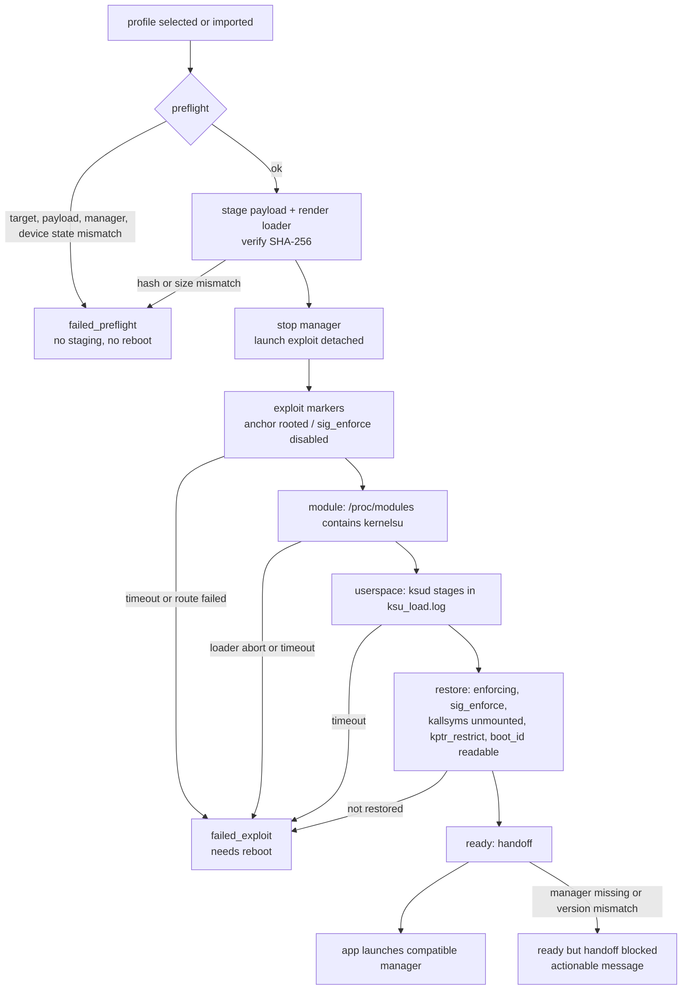
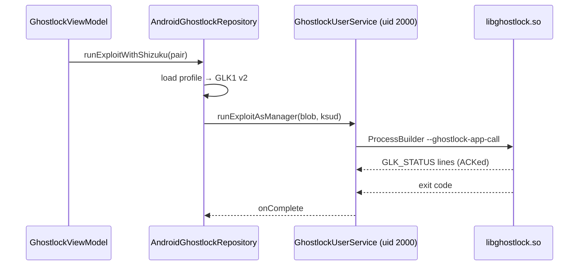
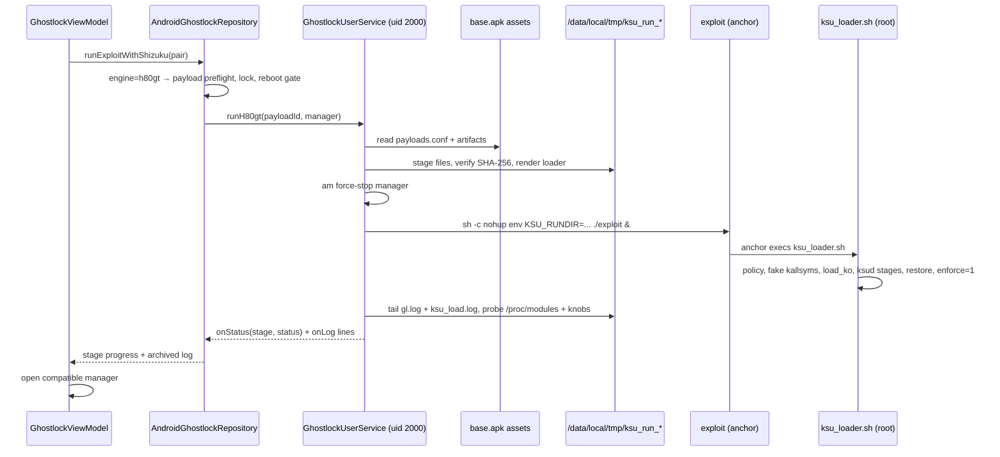

English | [简体中文](h80gt-integration-plan_ZH.md)

# H80GT integration plan (2026-10-29)

> Level L plan. It changes the profile schema (a new execution-engine selector), the
> app↔UserService contract (a new AIDL entry point) and the run state machine.
> Per `AGENTS.md`, implementation starts only after the user accepts this plan.
> Source of requirements: [`h80gt-integration-task.md`](h80gt-integration-task.md).

## Current state and baseline

| Item | Value |
|---|---|
| Upstream | `work/ghostlock-app`, `437b3b2` on `main`, clean except the two untracked task documents |
| H80GT | `work/GhostLock-H80GT`, `33541d1` (`v0.3.1`, shallow/grafted clone), clean |
| H80GT release bundle | `work/release/bundle/ghostlock/`, tarball SHA-256 `a5a3cff2c3172bd5debe2a4e4f71c69402c00c8cffd37906b1354437b4c8810e` |
| KernelSU reference | `work/KernelSU-v3.3.1` (not built, not linked; version only) |
| Device | none attached when this baseline was taken: `adb devices` was empty (adb 37.0.0 at `%LOCALAPPDATA%\Android\Sdk\platform-tools\adb.exe`, 2026-10-29). The device was connected later the same day; see [`device-gates/H80GT-01.md`](device-gates/H80GT-01.md) |
| Toolchain | JDK 21 + Gradle 9.7.1 (wrapper dist cached); no NDK, no `make`, no `clang`, no `cargo`; network reachable |
| Historical device evidence | `work/ksu-ui.xml` (2026-10-28 23:50): manager `me.weishu.kernelsu` v3.3.1, card shows 未安装/点击安装, kernel `5.10.236-android12-9-gd671cf8c2b02`, `HONOR 80 GT`, SELinux enforcing, seccomp filtered. The build fingerprint in that dump is deliberately not reproduced here: batch 2 selects by kernel string, and no build-instance string is shipped or compared |

What the two code bases actually do (read from source, not from the task text):

- Upstream: HOCON profile → `ProfileMerger` → `ProfileResolver` → `NativeProfileDocument` (GLK1 v2)
  → `libghostlock.so --ghostlock-app-call` (stdin) → native `root_child` frontend hands off to
  `ksud late-load` using the manager APK's `libksud.so`.
  `GhostlockUserService` (Shizuku, uid 2000, `Seccomp: 0`) is the only place that can run that
  binary; the in-app "direct" path runs as the app uid.
- H80GT: a per-firmware exploit binary (`sysctl` boot_id `ctl_table` hijack → arbitrary physical
  R/W → cred swap → permissive + `sig_enforce` flip) whose anchor child execs
  `$KSU_RUNDIR/ksu_loader.sh`. That rendered loader injects SELinux policy with `magiskpolicy`,
  bind-mounts a fake `/proc/kallsyms`, loads the custom `kernelsu.ko` with `bootid_ctl`/`bootid_buf`
  params, runs the `ksud` stages, restores `sig_enforce`/`kptr_restrict`/`panic_on_oops`, resumes
  `hisecd`, and re-enables enforcing as the very last step.
- The two chains share no execution primitive. The upstream generic `ksud late-load` cannot replace
  the H80GT chain: Honor strips kallsyms names, enforces module signatures at runtime and needs the
  policy injected *before* the module load.

Consequences that drive the design:

1. A profile alone cannot run the H80GT chain: the APK contains no code that stages the H80GT
   payload, renders the loader, or supervises the chain.
2. The chain must run from the Shizuku UserService (uid 2000, no seccomp). The app process cannot
   read `/data/local/tmp`, `/proc/modules`, `/sys/fs/selinux/*` or start the exploit.
3. The chain's success signal is *not* an exit code: the exploit daemonizes an anchor. The loader
   log, `/proc/modules` and the live security knobs are the evidence.
4. Any failure after the exploit starts can leave the `boot_id` `ctl_table` pointer redirected to a
   freed buffer. The H80GT contract is then "reboot before anything else".

## Goals and constraints

Goals:

- One shipped profile selects the H80GT engine for the exact `HONOR 80 GT / AGT-AN00 /
  9.0.0.230 / 5.10.236-android12-9-gd671cf8c2b02` combination; select it in the built-in list or
  import it, then run the whole chain from the GhostLock UI with no shell.
- Fail closed before any staging when device, firmware, kernel, payload, version or engine does not
  match; name the exact mismatch.
- Show the stage that is running, the stage that failed, and the recovery contract (reboot or not).
- After success, open the user-selected, version-checked KernelSU manager from the app foreground,
  or explain exactly why it cannot be opened.
- Keep per-run artifacts, evidence and logs; never let an old run fake a success.

Non-goals (explicit):

- No native/C++ changes, no new route, no GLK1 v2 change, no v3/v4 format.
- No re-implementation of the H80GT chain; it reuses the shipped binaries and the authoritative
  loader template verbatim.
- No writing to partitions, no persistence, no OTA, no module install, no boot-time hooks.
- No support for other H80GT firmwares, other devices or other KernelSU branches in this batch.
- No automatic retry after a failure (the contract requires a reboot between attempts).

## Decision

**Chosen: a profile-driven, app-owned H80GT execution adapter (option B of the task table).**

| Option | Evidence | Verdict |
|---|---|---|
| Profile only | The upstream executor can only produce a GLK1 blob consumed by `libghostlock.so`; the H80GT chain needs the exploit binary, the rendered loader, six payload files and a `KernelSU` module command line the native pipeline has no representation for | Rejected |
| Specialized adapter selected by the profile | The UI, Shizuku UserService, log relay, run-state persistence, manager scanner and debug archive are already generic; the adapter is additive and confined to Kotlin | **Chosen** |
| New native route/backend | A route is a PI-futex waiter geometry inside `Pipeline<F,B,M>`; the H80GT chain is a different vulnerability with its own process topology and loader. It would force a fake config surface and an attack-path gate on code we do not need to touch | Rejected |

The adapter is a **dispatcher**, not a new plugin platform: `engine = "native"` keeps every current
path byte-identical, `engine = "h80gt"` routes to the adapter. Only these two tokens exist.

## Contract

### Profile schema

Two new optional top-level keys. They are Kotlin-only: `NativeProfileDocument` never reads them, so
the GLK1 bytes of every existing profile are unchanged (enforced by the golden test).

```hocon
release = "5.10.236-android12-9-gd671cf8c2b02"   # the only hard key
schema_version = 1
engine = "h80gt"                       # absent => "native"
kernel_major = 5
recommend_shizuku = 1

h80gt {
  payload = "annap-AGT-AN00_9.0.0.230" # id in assets/h80gt/payloads.conf
  firmware = "9.0.0.230"
  manager_version = "3.3.0"            # KernelSU the module was built from
  # optional refinements; shipped profiles leave both out
  # device = "AGT-AN00"                # Build.MODEL, compared only when present
  # fingerprint = "<build fingerprint>" # compared only when present
}
```

Validation (`ProfileResolver.validateMerged`, fail closed):

| Rule | Error path |
|---|---|
| `engine` absent or `native` | native rules unchanged; `h80gt` must be absent |
| `engine` is any other token | `engine` — unknown execution engine |
| `engine = h80gt` | `route`, `fallback`, `task_struct`, `cred`, `offset` must be absent (a half-native profile is ambiguous and its blob would never be sent) |
| `engine = h80gt` | `payload`, `firmware`, `manager_version` (and the top-level `release`) required; `device`/`fingerprint` optional; `recommend_shizuku` must be `1` |
| `engine = h80gt` | native-only checks (cred geometry, route geometry, `offset.*` non-zero) are skipped; the run path is not native |

`ProfileMerger` skips `selected_cpus`, route presets and the native `execution` requirement for
`h80gt`; `ProfileExporter` writes no `.bin` for it (the exporter output set becomes "native-engine
releases"), and `AndroidProfileConfigController.nativeDocument()` returns `null`, so no code path can
hand an H80GT profile to `libghostlock.so`.

### Payload catalog

`app/src/main/assets/h80gt/payloads.conf` (checked in) describes every bundled payload: id, device,
release, fingerprint, firmware, manager version, source, license, bundle SHA-256 and one entry per
artifact. `assets/h80gt/payload/<id>/` holds the bytes and is generated (see Gradle below).

| Artifact | Staged as | Role | License | Size | SHA-256 |
|---|---|---|---|---|---|
| exploit (9.0.0.230) | `exploit` | exploit, exec | Apache-2.0 | 2221536 | `d195ca86d0d9a4157007b61d7a59275fdff3f24f15675ccb215bc3f011b2a169` |
| kernelsu.ko | `kernelsu.ko` | module | GPL-2.0 | 6588024 | `7b153982dd1c7354d7da41689df8b97dfc24aca54b467a6a43311071e5643037` |
| load_ko | `load_ko` | loader, exec | GPL-2.0 | 2142240 | `91cef87cc6f515e0bdde0ed7f2c1f25ca341ce75186b35b809135decf1884e84` |
| kmsg_dumper | `kmsg_dumper` | kmsg, exec | GPL-2.0 | 2140768 | `40258421b4822eb53f92391c4e04fa2df7fa9395142341d4208416edf64e3f80` |
| magiskpolicy | `magiskpolicy` | policy tool, exec | GPL-3.0 (Magisk) | 356584 | `9837db9db475eb74b6715f081768cb6a1f2fb5a2b2ac15755686062501bace27` |
| ksud | `ksud` | userspace, exec | GPL-2.0 | 4892712 | `99aaa607e9c9da6a0e898366ecf0a14dd67224ea726d952d1ce575e62d3b5c41` |
| ksu_rules | `ksu_rules` | policy rules | GPL-2.0 | 914 | `e60f0387c23967475a145f9ad56bea1fbabae6317684202e074d27af3faae757` |
| ksu_loader.tmpl | `ksu_loader.sh` (rendered) | loader template | GPL-2.0 | 11457 | `608a079aa86f50e539c70b52a1f15818fc35db82a97bdd1c5a766f5fce79aa1f` |

Provenance: the bytes are the official `v0.3.1` release bundle. The bundle's `ksu_loader.tmpl` and
`ksu_rules` are identical to `GhostLock-H80GT@33541d1:ksu/tools/*` after LF normalization (this
Windows checkout stores them with CRLF; the packaged copies MUST be LF). `load_ko`, `kmsg_dumper`
and `kernelsu.ko` are gitignored build products of that repository and exist only in the bundle.
The exploit binary is not rebuilt in this environment (no NDK/`make`); its reproduction command is
`exploit/docker-build.sh PROJECT=annap-AGT-AN00_9.0.0.230 bin` in the H80GT repository, and the
shipped bytes are hash-pinned here. Distribution obligation: the APK carries GPL-2.0/GPL-3.0
binaries; the deliverable ships the corresponding source locations and licenses in the artifact
manifest, and the APK is not published by this batch.

### Packaging (Gradle)

Root `build.gradle.kts` gains `prepareH80gtPayload`:

1. Resolve the source: `-Pghostlock.h80gt=<dir>` (directory containing `ghostlock/` = the unpacked
   bundle) or the default `../release/bundle` relative to the repository root.
2. Copy `<source>/ghostlock/exploits/9.0.0.230/exploit`, `kernelsu.ko`, `load_ko`, `kmsg_dumper`,
   `magiskpolicy`, `ksud`, `ksu_rules` into `app/src/main/assets/h80gt/payload/<id>/`, and
   `ksu_loader.tmpl` into `app/src/main/assets/h80gt/ksu_loader.tmpl`, normalizing CRLF→LF for the
   two text files.
3. Verify every copy against `payloads.conf` (size + SHA-256) and fail the build on mismatch, so a
   wrong or stale bundle can never be packaged.
4. `merge*Assets` and `testDebugUnitTest` depend on it.

If the source is missing the build fails with the exact expected path. `-Pghostlock.h80gt=off`
produces a build without the payload; the app then refuses `engine = h80gt` at preflight
("payload not bundled") instead of silently doing something else.

### Run layout and the authoritative loader

Run directory: `/data/local/tmp/ksu_run_<stamp>` where `<stamp>` is `yyyyMMdd_HHmmss`. The name is the
H80GT convention on purpose: the loader sweeps `/data/local/tmp/ksu_run_*` except `@STAMP@` and
salvages `prev_*` evidence from failed runs on its own. Every file the run needs lives in that
directory; nothing is written to a shared path except the two globals the loader itself cleans
(`/data/local/tmp/gl_anchor.log`, `gl_root_proof`), and this design moves the anchor log into the run
directory with `GL_ANCHOR_LOG`.

Loader rendering is the same substitution `release/setup.sh` performs, on the same template:

| Placeholder | Value | Why |
|---|---|---|
| `@RUNDIR@` | run directory | payload location |
| `@STAMP@` | the run stamp | the loader's own sweep excludes this run |
| `@FREEZE_HISECD@` | `1` | matches the shipped device flow: hisecd is SIGSTOPped for the load window and resumed on every exit path |
| `@ALLOW_SHELL@` | `0` | no `allow_shell=1` debug mode |
| `@STAGES@` | `1` | run the `ksud` post-fs-data/services/boot-completed/install stages |
| `@ENFORCE@` | `1` | the loader re-enables enforcing as its last step |

Exploit environment: only `KSU_RUNDIR` and `GL_ANCHOR_LOG`. `FLIP_SIG`, `FLIP_PERMISSIVE`,
`KSU_LOADER`, `KS_MAX_TRIES`, `SYSCTL_WALK_ATTEMPTS` and the three `LINK_*` addresses stay the
compile-time defaults baked from the target header — the app must not become a way to set them.
`KSU_LOADER=1` is already baked, and the loader file must exist *before* the exploit starts.

Launch: `/system/bin/sh -c 'cd <rd> && nohup env KSU_RUNDIR=<rd> GL_ANCHOR_LOG=<rd>/gl_anchor.log
./exploit > gl.log 2>&1 </dev/null &'`. The shell exits immediately; the chain is orphaned on
purpose and is never killed by the app (a killed parked waiter can panic the kernel).

### Stage machine



| Stage | Probe | Timeout | Pass | Fail classification |
|---|---|---|---|---|
| `preflight` | uid 2000 + `Seccomp: 0`; `os.version`/`Build.MODEL`/`Build.FINGERPRINT` vs profile+payload; payload entries present; `/proc/modules` has no kernelsu; no live `ksu_run_*` chain; `/sys/fs/selinux/enforce` = 1; `/data` free space | — | continue | `failed_preflight`, no reboot |
| `stage` | create run dir, extract every artifact from the APK zip, verify size+SHA-256, chmod 755 for exec roles, render loader, assert no `@TOKEN@` remains | — | continue | `failed_stage`, run dir removed, no reboot |
| `launch` | `am force-stop <manager>`, start the detached chain, `gl.log` created | 15 s | continue | `failed_launch`, needs reboot |
| `exploit` | `gl.log` contains `sysctl-route-ok` or (`anchor rooted` and `sig_enforce disabled`) | 900 s | continue | `failed_exploit`, needs reboot |
| `module` | `/proc/modules` contains `kernelsu` (case-insensitive) | 300 s | continue | `failed_module`, needs reboot |
| `userspace` | `ksu_load.log` shows `boot-completed exit=` and `install exit=` and the `ksud` listing | 300 s | continue | `failed_userspace`, needs reboot (module live) |
| `restore` | `enforce` = 1; `sig_enforce` = `1`/`Y` **when readable** (Honor denies uid 2000 that read, so an unreadable value is "cannot verify", never a failure); `/proc/self/mounts` has no `/proc/kallsyms`; `boot_id` reads as one stable 36-char UUID twice | 180 s | `ready` | `failed_restore`, needs reboot |
| `handoff` | manager package resolves, `versionName` matches `manager_version` | — | manager opened | `ready_handoff_blocked` |

Two failure groups only: `needs_reboot = false` (preflight/stage: nothing touched the kernel) and
`needs_reboot = true` (anything at or after `launch`, because the `boot_id` pointer may be
redirected; also "module loaded but restoring failed" is a permissive device, reboot first).

### State ownership and persistence

| Resource | Owner | Created | Released / terminated |
|---|---|---|---|
| GLK1 blob, native run state (`w1a..w3c`) | upstream, unchanged | native run | native exit |
| H80GT run state (`h80gt-run.json`: stamp, stage statuses, outcome, needs_reboot) | app | run start | run end; read at next start |
| H80GT run lock (`h80gt-run.lock`: stamp, engine, boot instant) | app | before Shizuku bind | run end, or explicitly cleared only when a completed run is found |
| Run directory and its files | UserService (creates) → exploit/loader (write) | `stage` | the loader sweeps foreign `ksu_run_*` at the next run; this run's directory stays as evidence |
| `gl.log`, `ksu_load.log`, `kmsg_cap.txt`, `stage_*.log` | exploit/loader (root) | chain | live-tailed by the UserService; post-enforcing reads may be denied, so evidence is the relayed stream |
| Detached chain processes | kernel/exploit itself | `launch` | never killed by the app; the loader's own cleanup handles its children |
| Chosen manager package | app preferences (existing) | user choice | unchanged |
| Manager lifecycle | UserService stops it before the chain; app starts it after success | — | — |

Concurrency: the existing `GhostlockUserService.running` flag serialises one chain per UserService
process; the app-side lock file plus the shell-side "no live `ksu_run_*` chain" check serialise across
app restarts. The `needs_reboot` gate compares the recorded boot instant
(`System.currentTimeMillis() - SystemClock.elapsedRealtime()`) with the current one; a real reboot
clears the block, a retry on the same boot does not.

### Manager handoff

- Candidate: the user-selected package if set, otherwise the payload's `manager { package }`.
- Compatibility: `versionName` normalized (leading `v`, trailing build suffix) must equal
  `h80gt.manager_version`. The module is built from KernelSU `v3.3.0`, and `ksu/ksu_ko_build.sh`
  states the real gate: `KSU_VERSION = 30000 + git rev-list --count HEAD` is computed at the tag and
  **the manager version-checks that number**. A manager built from a later commit therefore sees a
  lower kernel version and reports the module as not installed — the leading explanation for the
  historical "显示有权限但没有管理入口 / 未安装" symptom with the v3.3.1 manager
  (`work/ksu-ui.xml`). The plan does not claim that diagnosis as proven: the app only pins the
  manager version, blocks an automatic handoff on mismatch, and V6 stays an on-device observation.
- Launch from `MainActivity` (foreground) through `getLaunchIntentForPackage`, falling back to a
  resolved `LAUNCHER` activity; `ActivityNotFoundException` / no launcher becomes a user-visible
  message, never a silent no-op.
- Missing manager or version mismatch never falls back to another KernelSU branch: the run reports
  `ready` with `handoff blocked` and the reason, and the user gets the actionable steps.
- The app cannot verify the manager UI (授权入口, 工作中 `<LKM>`). V6 evidence therefore stays a
  manual, on-device observation; the app records the manager package/version it handed off to.

## Change list

### profile-core

| File | Change | Reason |
|---|---|---|
| `data/ExecutionEngine.kt` (new) | engine tokens, tolerant parse, `H80gtSpec` data class + parse/validate helpers | one authority for the selector and its fields |
| `data/profile/ProfileResolver.kt` | `KnownTopLevel` += `engine`, `h80gt`; `validateMerged` branches on the engine; `h80gtSpec()` | fail-closed validation, one place |
| `data/profile/ProfileMerger.kt` | skip `selected_cpus`/route presets/`execution` requirement for non-native engines | an H80GT profile carries no native tuning |
| `data/profile/ProfileExporter.kt` | skip non-native engines (and say so in the log) | no `.bin` exists for a non-native engine |
| `src/test/.../ExecutionEngineTest.kt` (new), `ProfileResolverTest.kt` | engine validation matrix | V1/V2 at the core layer |

### app

| File | Change | Reason |
|---|---|---|
| `data/h80gt/H80gtPayload.kt` (new) | `payloads.conf` model/parser, catalog from the APK zip, artifact specs, SHA-256 verification | one source for payload identity and integrity |
| `data/h80gt/H80gtPreflight.kt` (new) | pure `evaluate(facts, payload, profile, shellState, manager)` → verdict with blockers/warnings | V2 decisions testable without a device |
| `data/h80gt/H80gtLoader.kt` (new) | render the template, reject leftover tokens | keeps the shipped loader authoritative |
| `data/h80gt/H80gtRunState.kt` (new) | stage/status/outcome codec + lock/reboot bookkeeping | per-run state, no false success |
| `data/h80gt/H80gtShellProbe.kt` (new) | shell-side reads: `/proc/modules`, enforce, mounts, `kptr_restrict`, `boot_id`, uptime, chain liveness, free space; pure parsers split out | all device IO in one auditable place |
| `data/h80gt/H80gtExecutor.kt` (new) | stage → launch → poll → relay → verify, the stage machine above | the adapter itself |
| `data/h80gt/H80gtManager.kt` (new) | version normalization/compare, handoff decision | V6 gating without guessing |
| `shizuku/IGhostlockUserService.aidl` | `runH80gt(String payloadId, @nullable String managerPackage, IGhostlockCallback, IGhostlockStatusCallback) = 4` | app→shell entry point |
| `shizuku/GhostlockUserService.kt` | implement `runH80gt`, reuse the `running` guard, keep the existing native methods untouched | shell-side ownership |
| `data/AndroidProfileConfigController.kt` | `ProfileConfig` carries engine + spec; skip native validation for `h80gt`; `nativeDocument()` returns null | dispatch authority |
| `domain/model/GhostlockModels.kt` | `ProfileConfig.engine`, `ProfileConfig.h80gt`, run blocker enum, stage models | typed UI state |
| `domain/repository/GhostlockRepository.kt` | `runBlocker(...)`, `lastH80gtRun()`, `h80gtStageListener(...)`; `runExploit` refuses `h80gt` | UI needs refusal reasons, not just logs |
| `data/AndroidGhostlockRepository.kt` | dispatch by engine, H80GT run path, archive sidecars (`profile.conf`, `payload.conf`), manager handoff data, lock/reboot persistence | wiring |
| `ui/GhostlockViewModel.kt` | blocker toast, stage list, engine-aware controls, auto handoff effect | UX |
| `ui/GhostlockUI.kt` | engine row, stage progress block in the execution sheet, hide route/CPU/safe-mode for `h80gt` | "clearly show the stage" |
| `ui/MainActivity.kt` | `GhostlockEffect.OpenManager(package)` | foreground handoff |
| `res/values/strings.xml`, `res/values-zh/strings.xml` | new strings (blockers, stages, manager messages) | bilingual UI |
| `assets/kernel_profiles/annap-agt-an00-9.0.0.230.conf` (new), `index.conf` | the shipped H80GT profile | V1 |
| `assets/h80gt/payloads.conf` (new) | payload catalogue | V3 |
| `build.gradle.kts` (root) | `prepareH80gtPayload` + wiring | reproducible packaging |
| tests | `H80gtPayloadTest`, `H80gtPreflightTest`, `H80gtLoaderTest`, `H80gtManagerTest`, `H80gtRunStateTest`, `H80gtProfileTest`; `BuiltinProfilesTest`/`ExporterAgreementTest` filter to native engines | V1/V2/V3/V7 |

### docs

| File | Change |
|---|---|
| `docs/analysis/h80gt-integration-plan.md` / `_ZH.md` | this plan |
| `docs/h80gt-integration.md` / `_ZH.md` | user guide: prerequisites (Shizuku activation), install, run, failure/reboot rules, manager version, limitations |
| `docs/kernel_profiles/PROFILE_SCHEMA.md` / `_ZH.md` | `engine`/`h80gt` reference section |
| `docs/analysis/h80gt-integration-task*.md` | progress checkboxes updated at the end |

## Data-flow and control-flow differences

Native engine (unchanged):



H80GT engine (new):



Invariants kept:

- `NativeProfileDocument` bytes for every existing profile are unchanged (golden hash test).
- The native command line, its stdin framing, the `GLK_STATUS` ACK channel and `GHOSTLOCK_*`
  environment are untouched.
- No log read sits on the chain's critical path: the chain writes to files and the tailer polls
  files (the same reason the native path moved off pipe capture).
- The app never writes to `/proc/sys/*`, `/sys/fs/selinux/*` or `/sys/module/*`; only the loader
  (root) does.

## Failure handling and recovery contract

| Situation | App behaviour |
|---|---|
| Mismatch at preflight | refuse, list every mismatch, no staging, no reboot needed |
| Payload hash/size mismatch | refuse, delete the run directory, no chain started |
| Exploit timeout / `route failed` | stop supervising, keep the log, mark `needs_reboot`, tell the user to reboot |
| Loader abort (`sig_enforce was not disabled`, `bind-mount failed`, `policy check failed`) | same as above; the loader already ran its abort cleanup |
| Module never appears | same as above |
| Module live but `ksud` stage timeout | `failed_userspace`, `needs_reboot` |
| `enforce` stays 0 or `sig_enforce` stays 0 | `failed_restore`, `needs_reboot`, do not open the manager |
| Success | `ready`, hand off |
| Retry while `needs_reboot` and the boot instant did not change | blocked before Shizuku bind |
| KernelSU module already loaded at preflight | blocked: "reboot first" (a stale module fakes success) |
| Second tap / second run | blocked by the run lock; the button is disabled while running |

No automatic retry. No `destroyForcibly` on chain processes. No concurrent chain.

## Compatibility and rollback

- Backwards compatible: profiles without `engine` behave exactly as before; the exporter output for
  existing profiles is unchanged; native wire format untouched.
- Existing user documents with unknown top-level keys were already rejected; `engine` is the only new
  accepted key, so no previously valid document becomes invalid.
- The H80GT profile is additive; removing its `index.conf` line, the `assets/h80gt` payload and the
  AIDL method returns the tree to upstream behaviour (the app then simply has one engine).
- Rollback on device: the adapter writes nothing persistent. The loader's own cleanup removes the
  transient files; the module lives until reboot. Uninstalling the app leaves only the
  shell-owned run directories under `/data/local/tmp`.
- If the KernelSU module build (3.3.0) turns out to need a different manager, only
  `payloads.conf`/profile `manager_version` changes — no code change.

## Verification matrix

| ID | Check | Command / evidence | Status |
|---|---|---|---|
| V1 | profile import/save/select/dispatch | `:profile-core:test` 26/26, `H80gtProfileTest` (3 cases: builtin, imported, unknown engine), `BuiltinProfilesTest` skips non-native engines | done (host) |
| V2 | wrong model/kernel/missing artifact/unknown engine/incompatible version refused before run | `H80gtPreflightTest` (12 cases), `ExecutionEngineTest` (8 cases), archived run log lines | done (host) |
| V3 | APK carries the expected artifacts/versions/sources | `prepareH80gtPayload` + `verifyH80gtPayload` (8/8 ok), `H80gtPayloadTest` (5 cases), APK entry hashes re-checked against the manifest | done |
| V4 | full chain from the UI | device gate [`device-gates/H80GT-01.md`](device-gates/H80GT-01.md): all eight stages completed, `exit code=0`, app log + archive | **PASS (2026-10-29)** |
| V5 | module + userspace + restore proven | same gate: `kernelsu … Live`, ksud stages `exit=0`, `sig_enforce=Y`, `umount OK`, `kptr restored=2`, `boot_id` unchanged, no reboot | **PASS** |
| V6 | manager opened, version matches, authorization works | same gate: `工作中 [越狱模式]`, `32601-2`, manager `v3.3.0`, 超级用户/设置 entries render. App root **passes after an explicit grant**: after enabling the app's 「超级用户」 switch, `su -c id` returns `uid=0(root) … context=u:r:ksu:s0`; MT Manager shows the same (`mtio` daemons as uid 0). Unlisted apps get `ENOENT` with **no prompt** in this session, so the grant is a manager-side action | **PASS** |
| V7 | repeated taps / stale session / timeouts | `H80gtRunStateTest` (7 cases) + on-device second Run refused with `MODULE_ALREADY_LOADED`, no staging | done (host + device) |
| V8 | existing profiles and routes regress clean | `:app:testDebugUnitTest` 126 tests: 124 pass, 2 failures reproduce identically on the pristine baseline `437b3b2` (`ExporterAgreementTest` byte 1397 of one 6.1.138 profile, `ProfileMigrationEquivalenceTest` fixture missing four 6.x releases); exporter set and golden hashes unchanged for all existing profiles | done, with two pre-existing baseline failures |

Build evidence (2026-10-29): `:app:assembleDebug` succeeded; APK
`build/app/outputs/apk/debug/GhostLock-v1.2(1)-arm64-v8a-debug.apk`, 30,967,655 bytes,
SHA-256 `013139c05ee56fdb507ef5832cd82074766ebad0c2fe1e907b591b728d36b741`; this is the exact
binary the H80GT-01 gate ran.

Native checks (`make -C src native-host-tests`, NDK build, `lint-tidy`) are not applicable: no
`src/` file changes. If the batch ends up touching native code, they become mandatory.

## Batch 2: multi-firmware and optional fingerprint (approved 2026-10-30)

The first batch proved the chain on one exact combination (`9.0.0.230`). The community flow it wraps
(`GhostLock-H80GT`) has **18 firmware targets, 6 of them device-verified**, and it selects between
them purely on `uname -r` — no model and no fingerprint. Batch 1's exact-fingerprint binding was
therefore stricter than the port needs and made every additional firmware depend on data nobody has
recorded.

**Goal:** ship the 6 H80GT-verified firmwares in one APK, keep fail-closed selection, and let the
first person to run a firmware mark it verified on their device.

### Contract changes

| Item | Batch 1 | Batch 2 |
|---|---|---|
| `h80gt.payload` | required | required (one per firmware) |
| `h80gt.release` (top-level `release`) | required, exact | required, exact — this stays the only hard key |
| `h80gt.firmware` | required | required (the MagicOS version, informational + payload cross-check) |
| `h80gt.manager_version` | required | required |
| `h80gt.device` | required (`Build.MODEL`) | **optional**: when present it is compared, when absent it is not |
| `h80gt.fingerprint` | required | **optional**: same rule |
| payload `device` / `fingerprint` | required | **optional**, same rule as the profile |
| payload `status` | informational | informational and shown in the log; only `verified` payloads ship in this batch, so no consent dialog is needed yet. Adding an `untested` one later needs the confirm step (not implemented) |

Selection still compares the profile, the payload catalogue and the device on every field that is
declared, so an absent fingerprint can never match a different kernel (the kernel string is still an
exact key) and a declared one is still enforced.

### Payload set (all H80GT-verified)

| Payload id | Firmware | Kernel (`release`) | H80GT status |
|---|---|---|---|
| `annap-AGT-AN00_8.0.0.128` | 8.0.0.128 | `5.10.168-android12-9-g804a21a522f0` | verified |
| `annap-AGT-AN00_8.0.0.160` | 8.0.0.160 | `5.10.209-android12-9-g516fa23f87fc` | verified |
| `annap-AGT-AN00_9.0.0.157` | 9.0.0.157 | `5.10.209-android12-9-ga3ff7ae30334` | verified |
| `annap-AGT-AN00_9.0.0.200SP1` | 9.0.0.200SP1 | `5.10.236-android12-9-gd1575ab10b30` | verified |
| `annap-AGT-AN00_9.0.0.220SP2` | 9.0.0.220SP2 | `5.10.236-android12-9-ga88335e8db40` | verified |
| `annap-AGT-AN00_9.0.0.230` | 9.0.0.230 | `5.10.236-android12-9-gd671cf8c2b02` | verified (also gated by H80GT-01) |

The exploit binary is per firmware (~2.2 MB each). Everything else (`kernelsu.ko`, `load_ko`,
`kmsg_dumper`, `magiskpolicy`, `ksud`, `ksu_rules`, `ksu_loader.tmpl`) is identical across them and
is staged **once** under `assets/h80gt/shared/`; a payload only owns its exploit. Without that split
the APK would carry six copies of the 6.6 MB module.

### Fork patch in the shipped exploits

Three app-path attempts on `9.0.0.230` failed inside the upstream exploit's physical-page walk
(`SKIP out-of-ram`, see H80GT-02). The cause is `prepare_dm_page()` accepting a page whose alias is
past `DIRECT_MAP_END`, which `sysctl_do_walk()` then refuses — forever, because the page is never
retired. The fork applies the minimal fix (retire the page) to `exploit/src/util.c`, rebuilds all six
per-firmware exploits with NDK r29 (`-static -O2`), and pins the new bytes in the catalogue. The
shared set is untouched. Details, logs and the diff:
[`upstream-issue-h80gt-dm-page.md`](upstream-issue-h80gt-dm-page.md).

### Per-device verification record

A successful run stores `payload id + release + boot instant` in app preferences. The execution sheet
and the debug archive note whether this is the device's first successful run of that firmware. This is
a local record only: it never edits the signed manifest, and it is what lets "the first person to run
a firmware" close the verification loop for themselves.

### Files

| File | Change |
|---|---|
| `profile-core/.../ExecutionEngine.kt` | `H80gtSpec.device` / `.fingerprint` nullable |
| `profile-core/.../h80gt/H80gtPayload.kt` | payload `device` / `fingerprint` nullable |
| `app/.../h80gt/H80gtPreflight.kt` | compare only declared fields |
| `app/.../h80gt/H80gtExecutor.kt`, `H80gtManager` call sites | nullable spec view |
| `app/.../AndroidGhostlockRepository.kt` | nullable payload summary, local verified record |
| `app/src/main/assets/h80gt/payloads.conf` | six payloads, shared artifact paths |
| `app/src/main/assets/kernel_profiles/annap-agt-an00-*.conf` (5 new) + `index.conf` | one profile per verified firmware |
| `build.gradle.kts` (root) | stage six exploits + the shared set once |
| tests | optional-field cases, six-payload catalogue, first-run record |
| `docs/h80gt-integration*.md`, `PROFILE_SCHEMA*.md`, task brief | six supported firmwares, optional fields, consent rule |

### Verification

1. `:profile-core:test`, `:app:testDebugUnitTest`; new cases: a profile without `device`/`fingerprint`
   resolves and preflights, and a *declared* fingerprint still refuses a mismatch.
2. `verifyH80gtPayload` must report 6 payloads / 13 artifacts (6 exploits + 7 shared).
3. Rebuild the APK, confirm every payload entry hashes inside it.
4. Re-run the H80GT-01 gate on the one device available (`9.0.0.230`) after a reboot, to prove batch 2
   did not regress the proven combination. The other five stay "verified upstream, not run here".

### Explicit preservation

Native code, GLK1, routes, the existing profiles, the loader rendering and the recovery contract are
untouched; the batch only widens selection and packaging.

## Explicit preservation

- `src/core/**`: untouched. No route, no component, no wire change, no attack-path gate.
- `NativeProfileDocument`, `profile/binary.cpp`, `RouteKind` catalog agreement: untouched.
- `RunStateCodec` (`w1a..w3c`) and the W3 Shizuku suggestion: untouched; H80GT uses its own state
  file so the two cannot mix.
- `LegacyProfileConverter` v1 conversion: untouched.
- `kernelsnitch/`: untouched.
- `GhostlockUserService.runExploit/runExploitAsManager`, their AIDL ids and semantics: untouched.
- The bundled `kernel_profiles/*.conf` other than `index.conf`: untouched.

## Open questions and unverified items

1. **Device verification: done** on 2026-10-29 ([`device-gates/H80GT-01.md`](device-gates/H80GT-01.md)).
   The two behaviours corrected by that gate (`sig_enforce` readability, refusal visibility) are in
   the tree; the exact binary that ran is recorded there.
2. **Manager version.** The 3.3.0 manager works: `工作中 [越狱模式]`, `32601-2`, management and
   settings entries render. The historical "未安装 / no management entry" symptom with the 3.3.1
   manager remains a hypothesis (manager version-checks `KSU_VERSION`); it was not re-tested.
3. **App root: works, but needs an explicit grant.** In this late-load session KernelSU does not prompt
   for an unlisted app (its `su` exec returns `ENOENT`); enabling the app's 「超级用户」 switch in the
   manager's App Profile page makes `su -c id` return `uid=0(root) … context=u:r:ksu:s0`. MT Manager
   already had such a grant (`mtio` daemons as uid 0), which is what confirmed it. Documentation and
   the usage guide must say "grant first", not "no prompt".
4. **Payload reproduction.** The exploit binary and the module are shipped prebuilt (hashes pinned).
   Rebuilding them needs NDK + the MagicOS kernel tree; the commands are recorded in the manifest.
5. **`hisecd` freeze risk.** Observed working on the device (`frozen pid=1884` → `resumed pid=1884`);
   a loader killed mid-window would still leave it frozen, so the "never kill the chain" rule stays.
6. **`ksud install` / `/data/adb` access.** `userspace` is inferred from the loader's own log lines
   (`install exit=0`) because the shell cannot read `/data/adb`; if the loader's output changes, the
   probe must follow.

## Progress

- [x] Baseline, code evidence, device and toolchain state recorded
- [x] Plan accepted by the user (2026-10-29)
- [x] profile-core engine support + tests
- [x] app adapter (payload, preflight, loader, run state, executor, manager) + tests
- [x] AIDL/UserService/ViewModel/UI wiring
- [x] assets, Gradle packaging, usage docs
- [x] local verification (tests, APK, hashes)
- [x] device verification ([`device-gates/H80GT-01.md`](device-gates/H80GT-01.md), 2026-10-29)

## Device findings that changed the implementation

The H80GT-01 gate ran on the real device and produced two corrections, both already in the tree and
covered by the gate:

1. **`sig_enforce` and `kptr_restrict` are unreadable by the shell uid** on MagicOS 9.0.0.230
   (SELinux denies uid 2000). The `restore` stage now treats an unreadable value as "cannot verify"
   and still fails on an explicit `0`/`N`; the loader's own log carries the restored values
   (`sig_enforce=Y`, `kptr restored=2`).
2. **A refusal must stay readable.** The blocker reason now opens the execution sheet (not only a
   toast), which is what the on-device repeat-run check (`MODULE_ALREADY_LOADED`) relies on.

Platform prerequisite found during the gate: this device's Shizuku server crashed with
`UnsatisfiedLinkError: … base.apk!/lib/arm64-v8a/librish.so`; reinstalling the same official APK
(`pm install -r`) and re-running `start.sh` fixed it. It is documented in the usage guide, not
picked up by the integration.
