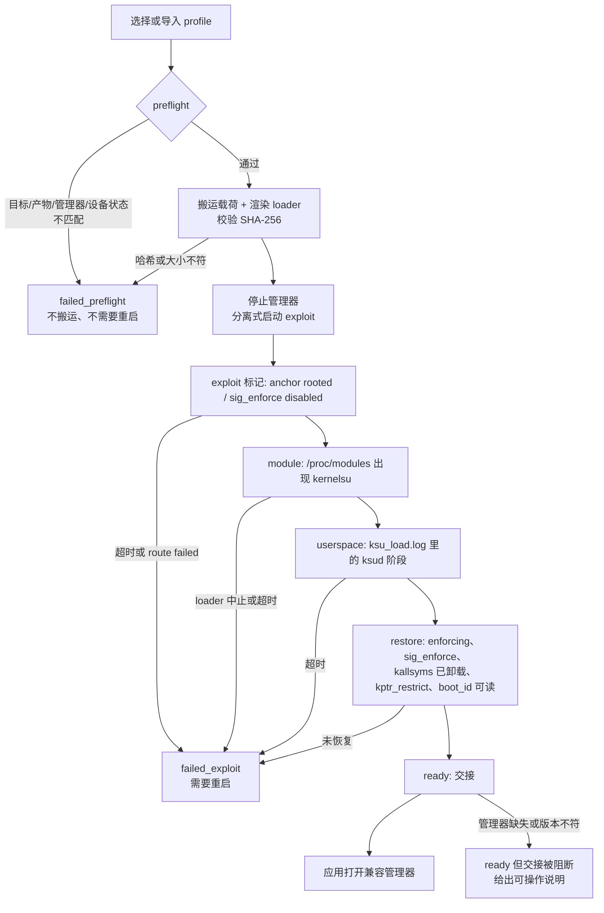
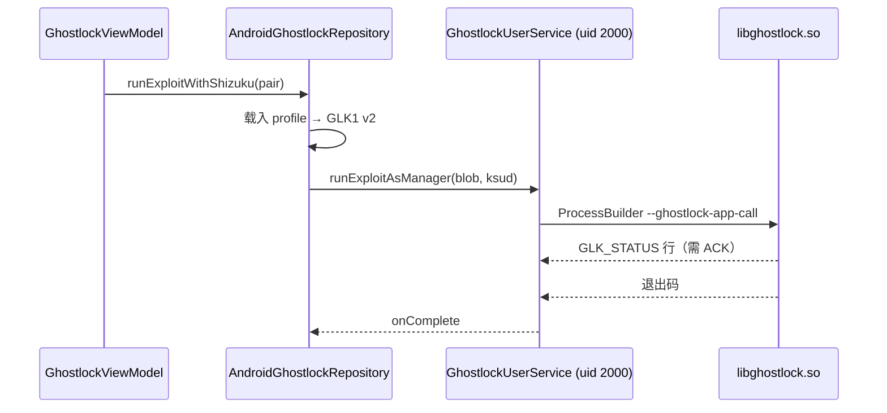
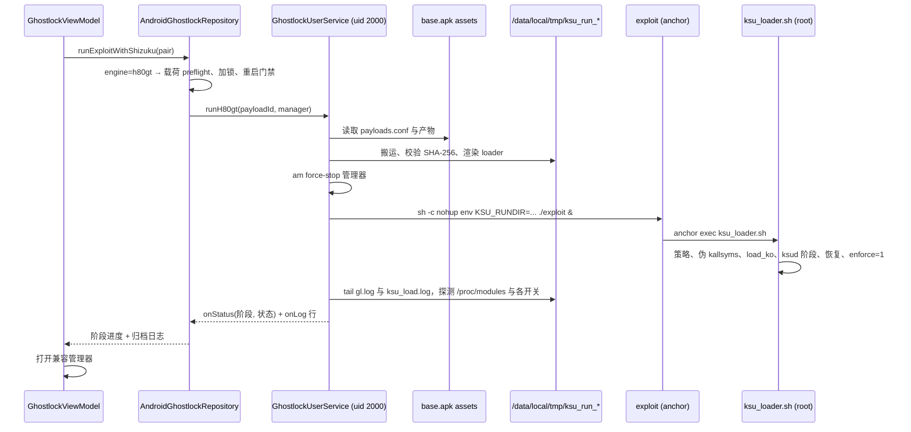

简体中文 | [English](h80gt-integration-plan.md)

# H80GT 接入具体设计（2026-10-29）

> L 级计划。它改变 profile 格式（新增执行引擎选择器）、应用↔UserService 契约（新增 AIDL 入口）
> 和运行状态机。按 `AGENTS.md`，用户认可本计划后才开始实现。
> 需求来源：[`h80gt-integration-task_ZH.md`](h80gt-integration-task_ZH.md)。

## 现状与基线

| 项目 | 值 |
|---|---|
| 上游 | `work/ghostlock-app`，`437b3b2`，`main`；除两份未跟踪的任务书外工作树干净 |
| H80GT | `work/GhostLock-H80GT`，`33541d1`（`v0.3.1`，浅克隆），工作树干净 |
| H80GT 发版包 | `work/release/bundle/ghostlock/`，tar 包 SHA-256 `a5a3cff2c3172bd5debe2a4e4f71c69402c00c8cffd37906b1354437b4c8810e` |
| KernelSU 参考 | `work/KernelSU-v3.3.1`（未构建、未链接，仅作版本对照） |
| 设备 | 取基线时未连接：`adb devices` 为空（adb 37.0.0，`%LOCALAPPDATA%\Android\Sdk\platform-tools\adb.exe`，2026-10-29）。当日稍后已连上设备，见 [`device-gates/H80GT-01_ZH.md`](device-gates/H80GT-01_ZH.md) |
| 工具链 | JDK 21 + Gradle 9.7.1（wrapper 发行版已缓存）；没有 NDK、`make`、`clang`、`cargo`；网络可用 |
| 历史设备证据 | `work/ksu-ui.xml`（2026-10-28 23:50 导出）：管理器 `me.weishu.kernelsu` v3.3.1 (32680-5)，“未安装/点击安装”，内核 `5.10.236-android12-9-gd671cf8c2b02`，`HONOR 80 GT`，SELinux 强制执行，Seccomp 过滤。该 dump 里的构建指纹不再抄录：第二批按内核串选择，不随包携带也不比较任何构建实例字符串 |

两个代码库实际做什么（读源码，不引用任务书结论）：

- 上游：HOCON profile → `ProfileMerger` → `ProfileResolver` → `NativeProfileDocument`（GLK1 v2）
  → `libghostlock.so --ghostlock-app-call`（stdin）→ native `root_child` 前端用管理器 APK 里的
  `libksud.so` 做 `ksud late-load`。只有 `GhostlockUserService`（Shizuku，uid 2000，`Seccomp: 0`）
  能这样启动它；应用内“直连”路径以应用自身 uid 运行。
- H80GT：按固件编译的 exploit（劫持 `boot_id` 的 `ctl_table` → 任意物理读写 → cred 替换 →
  permissive + 翻转 `sig_enforce`），其 anchor 子进程 exec `$KSU_RUNDIR/ksu_loader.sh`。渲染后的
  loader 用 `magiskpolicy` 注入 SELinux 策略、bind-mount 伪造 `/proc/kallsyms`、带
  `bootid_ctl`/`bootid_buf` 参数加载定制 `kernelsu.ko`、跑 `ksud` 各阶段、恢复
  `sig_enforce`/`kptr_restrict`/`panic_on_oops`、恢复 `hisecd`，最后一步才重新 enforcing。
- 两条链没有共享的执行原语。上游通用 `ksud late-load` 不能替代 H80GT 链：荣耀抹掉 kallsyms
  符号名、运行时强制模块签名，且策略必须在模块加载前注入。

由此得出（设计依据）：

1. 只给上游 APK 一份 profile 无法跑 H80GT 链：APK 里没有任何代码去搬运 H80GT 产物、渲染 loader
   或监管整条链。
2. 链必须在 Shizuku UserService（uid 2000，无 seccomp）里跑。应用进程读不到 `/data/local/tmp`、
   `/proc/modules`、`/sys/fs/selinux/*`，也无法启动 exploit。
3. 链的成功信号不是退出码：exploit 会把 anchor 放到后台。证据是 loader 日志、`/proc/modules`
   和实时安全开关状态。
4. exploit 启动之后的任何失败都可能让 `boot_id` 的 `ctl_table` 指针指向已释放缓冲。此时 H80GT
   的契约是“先重启，别的都别做”。

## 目标与约束

目标：

- 随 APK 提供一份 profile，精确绑定 `荣耀 80 GT / AGT-AN00 / 9.0.0.230 /
  5.10.236-android12-9-gd671cf8c2b02`；可在内置列表选择或导入，然后从 GhostLock 界面完成整条链，
  不需要 shell。
- 设备、固件、内核、产物、版本或引擎任一不匹配时，在任何搬运之前 fail closed，并指明具体哪一项。
- 显示正在执行的阶段、失败所处阶段，以及恢复契约（是否需要重启）。
- 成功后由应用前台打开用户选定、版本核验过的 KernelSU 管理器；打不开时给出可操作原因。
- 每次运行保留独立产物、证据和日志；旧运行不得伪造成功。

明确不做：

- 不改 native/C++、不新增 route、不改 GLK1 v2、不引入 v3/v4。
- 不重写 H80GT 链；原样复用它已发布的产物和权威 loader 模板。
- 不刷写分区、不做持久化、不做 OTA、不自动装模块、不做开机钩子。
- 本批不支持其他 H80GT 固件、其他机型、其他 KernelSU 分支。
- 失败后不自动重试（契约要求两次尝试之间必须重启）。

## 决策

**采用：profile 驱动、应用侧自有的 H80GT 执行适配层（任务书方案的 B）。**

| 方案 | 代码证据 | 结论 |
|---|---|---|
| 只新增 profile | 上游执行器只能产出 GLK1 交给 `libghostlock.so`；H80GT 需要 exploit 产物、渲染后的 loader、6 个载荷文件，以及 native 管线无法表达的 `KernelSU` 模块命令行 | 否决 |
| profile 驱动的专用执行适配层 | UI、Shizuku UserService、日志回传、运行状态持久化、管理器扫描、调试归档都已是通用设施；适配层是纯加成、只落在 Kotlin | **采用** |
| 新增 native route/backend | route 是 `Pipeline<F,B,M>` 里的 PI-futex waiter 几何；H80GT 是另一个漏洞、另一套进程拓扑和 loader。会被迫造出假配置面，并对不必要触碰的代码触发攻击路径门禁 | 否决 |

适配层是**分派器**，不是新插件平台：`engine = "native"` 保持现有每条路径字节不变，
`engine = "h80gt"` 交给适配层。只有这两个 token。

## 契约

### profile 格式

新增两个可选顶层键。它们只存在于 Kotlin 侧：`NativeProfileDocument` 永不读取，因此所有既有
profile 的 GLK1 字节不变（由 golden 测试保证）。

```hocon
release = "5.10.236-android12-9-gd671cf8c2b02"
schema_version = 1
engine = "h80gt"                       # 缺省 => "native"
kernel_major = 5
recommend_shizuku = 1

h80gt {
  payload = "annap-AGT-AN00_9.0.0.230" # assets/h80gt/payloads.conf 里的 id
  firmware = "9.0.0.230"
  manager_version = "3.3.0"            # 模块编译所用的 KernelSU 版本
  # 可选收紧项；随包 profile 都不声明
  # device = "AGT-AN00"                # Build.MODEL，仅在声明时比较
  # fingerprint = "构建指纹"           # 仅在声明时比较
}
```

校验（`ProfileResolver.validateMerged`，fail closed）：

| 规则 | 错误路径 |
|---|---|
| `engine` 缺省或 `native` | native 规则不变；`h80gt` 必须缺席 |
| `engine` 为其他任何值 | `engine` —— 未知执行引擎 |
| `engine = h80gt` | `route`、`fallback`、`task_struct`、`cred`、`offset` 必须缺席（半 native profile 语义含糊，其 blob 也永不会被发送） |
| `engine = h80gt` | `payload`/`firmware`/`manager_version`（以及顶层 `release`）必填；`device`/`fingerprint` 可选；`recommend_shizuku` 必须为 `1` |
| `engine = h80gt` | 跳过仅 native 适用的检查（cred 几何、route 几何、`offset.*` 非零）；该 profile 不走 native 运行路径 |

`ProfileMerger` 对非 native 引擎跳过 `selected_cpus`、route 预设和 `execution` 必需项；
`ProfileExporter` 不为它写 `.bin`（导出集合变成“native 引擎的 release”），且
`AndroidProfileConfigController.nativeDocument()` 返回 `null`，任何代码路径都无法把 H80GT
profile 交给 `libghostlock.so`。

### 产物目录

`app/src/main/assets/h80gt/payloads.conf`（入库）描述每个随 APK 提供的载荷：id、device、release、
fingerprint、firmware、管理器版本、来源、许可证、发版包 SHA-256，以及每个产物一条记录。
`assets/h80gt/payload/<id>/` 存放字节，由构建生成（见下节 Gradle）。

| 产物 | 落地名 | 角色 | 许可证 | 大小 | SHA-256 |
|---|---|---|---|---|---|
| exploit (9.0.0.230) | `exploit` | exploit，可执行 | Apache-2.0 | 2221536 | `d195ca86d0d9a4157007b61d7a59275fdff3f24f15675ccb215bc3f011b2a169` |
| kernelsu.ko | `kernelsu.ko` | module | GPL-2.0 | 6588024 | `7b153982dd1c7354d7da41689df8b97dfc24aca54b467a6a43311071e5643037` |
| load_ko | `load_ko` | loader，可执行 | GPL-2.0 | 2142240 | `91cef87cc6f515e0bdde0ed7f2c1f25ca341ce75186b35b809135decf1884e84` |
| kmsg_dumper | `kmsg_dumper` | kmsg，可执行 | GPL-2.0 | 2140768 | `40258421b4822eb53f92391c4e04fa2df7fa9395142341d4208416edf64e3f80` |
| magiskpolicy | `magiskpolicy` | 策略工具，可执行 | GPL-3.0 (Magisk) | 356584 | `9837db9db475eb74b6715f081768cb6a1f2fb5a2b2ac15755686062501bace27` |
| ksud | `ksud` | 用户态，可执行 | GPL-2.0 | 4892712 | `99aaa607e9c9da6a0e898366ecf0a14dd67224ea726d952d1ce575e62d3b5c41` |
| ksu_rules | `ksu_rules` | 策略规则 | GPL-2.0 | 914 | `e60f0387c23967475a145f9ad56bea1fbabae6317684202e074d27af3faae757` |
| ksu_loader.tmpl | `ksu_loader.sh`（渲染后） | loader 模板 | GPL-2.0 | 11457 | `608a079aa86f50e539c70b52a1f15818fc35db82a97bdd1c5a766f5fce79aa1f` |

来源：字节取自官方 `v0.3.1` 发版包。发版包的 `ksu_loader.tmpl` 与 `ksu_rules` 与
`GhostLock-H80GT@33541d1:ksu/tools/*` 在 LF 归一化后完全一致（本 Windows 检出把它们存成 CRLF，
打包件必须是 LF）。`load_ko`、`kmsg_dumper`、`kernelsu.ko` 是该仓库被忽略的构建产物，只存在于
发版包。本环境没有 NDK/`make`，exploit 未重新编译；复现命令为 H80GT 仓库的
`exploit/docker-build.sh PROJECT=annap-AGT-AN00_9.0.0.230 bin`，随包字节在此被哈希锁定。
分发义务：APK 含 GPL-2.0/GPL-3.0 二进制；交付物在产物清单里给出对应源码位置与许可证，本批不发布
该 APK。

### 打包（Gradle）

根 `build.gradle.kts` 新增 `prepareH80gtPayload`：

1. 解析来源：`-Pghostlock.h80gt=<dir>`（含 `ghostlock/` 的解包目录），缺省为仓库根的
   `../release/bundle`。
2. 把 `<source>/ghostlock/exploits/9.0.0.230/exploit`、`kernelsu.ko`、`load_ko`、`kmsg_dumper`、
   `magiskpolicy`、`ksud`、`ksu_rules` 复制到 `app/src/main/assets/h80gt/payload/<id>/`，把
   `ksu_loader.tmpl` 复制到 `app/src/main/assets/h80gt/ksu_loader.tmpl`；两个文本文件做 CRLF→LF。
3. 按 `payloads.conf` 逐个核对（大小 + SHA-256），不一致直接让构建失败，错误或过期的发版包不可能
   被打进 APK。
4. `merge*Assets` 与 `testDebugUnitTest` 依赖它。

来源缺失时构建失败并打印期望路径。`-Pghostlock.h80gt=off` 生成不带载荷的构建；此时应用在
preflight 拒绝 `engine = h80gt`（“payload not bundled”），不会悄悄做别的事。

### 运行目录与权威 loader

运行目录：`/data/local/tmp/ksu_run_<stamp>`，`<stamp>` 为 `yyyyMMdd_HHmmss`。刻意沿用 H80GT
命名：loader 会清扫除 `@STAMP@` 之外的 `/data/local/tmp/ksu_run_*`，并从失败运行里抢救 `prev_*`
证据。本次运行所需文件都在该目录；除 loader 自己会清理的两个全局文件
（`/data/local/tmp/gl_anchor.log`、`gl_root_proof`）外不写共享路径，而本设计用 `GL_ANCHOR_LOG`
把 anchor 日志也放进运行目录。

loader 渲染与 `release/setup.sh` 对同一模板做的替换完全相同：

| 占位符 | 值 | 理由 |
|---|---|---|
| `@RUNDIR@` | 运行目录 | 载荷位置 |
| `@STAMP@` | 本次运行 stamp | loader 自己的清扫会排除本次 |
| `@FREEZE_HISECD@` | `1` | 与已发布设备流程一致：加载窗口内 SIGSTOP hisecd，所有退出路径恢复 |
| `@ALLOW_SHELL@` | `0` | 不启用 `allow_shell=1` 调试模式 |
| `@STAGES@` | `1` | 执行 `ksud` 的 post-fs-data/services/boot-completed/install 阶段 |
| `@ENFORCE@` | `1` | loader 最后一步重新 enforcing |

exploit 环境：只设 `KSU_RUNDIR` 与 `GL_ANCHOR_LOG`。`FLIP_SIG`、`FLIP_PERMISSIVE`、`KSU_LOADER`、
`KS_MAX_TRIES`、`SYSCTL_WALK_ATTEMPTS` 和三个 `LINK_*` 地址保持由 target 头文件烘焙的编译期默认值
——应用不得成为设置它们的通道。`KSU_LOADER=1` 已烘焙，且 loader 文件必须在 exploit 启动前就位。

启动：`/system/bin/sh -c 'cd <rd> && nohup env KSU_RUNDIR=<rd> GL_ANCHOR_LOG=<rd>/gl_anchor.log
./exploit > gl.log 2>&1 </dev/null &'`。shell 立即退出；链被刻意变成孤儿进程，应用永不杀它
（杀掉停驻的 waiter 可能让内核 panic）。

### 阶段机



| 阶段 | 探测 | 超时 | 通过 | 失败归类 |
|---|---|---|---|---|
| `preflight` | uid 2000 + `Seccomp: 0`；`os.version`/`Build.MODEL`/`Build.FINGERPRINT` 对比 profile+payload；载荷齐备；`/proc/modules` 无 kernelsu；无存活 `ksu_run_*` 链；`/sys/fs/selinux/enforce` = 1；`/data` 可用空间 | — | 继续 | `failed_preflight`，不需要重启 |
| `stage` | 建运行目录、从 APK zip 抽取每个产物、核对大小+SHA-256、按角色 chmod 755、渲染 loader、断言无残留 `@TOKEN@` | — | 继续 | `failed_stage`，删除运行目录，不需要重启 |
| `launch` | `am force-stop <manager>`、分离式启动、`gl.log` 出现 | 15 秒 | 继续 | `failed_launch`，需要重启 |
| `exploit` | `gl.log` 出现 `sysctl-route-ok`，或（`anchor rooted` 且 `sig_enforce disabled`） | 900 秒 | 继续 | `failed_exploit`，需要重启 |
| `module` | `/proc/modules` 出现 `kernelsu`（忽略大小写） | 300 秒 | 继续 | `failed_module`，需要重启 |
| `userspace` | `ksu_load.log` 出现 `boot-completed exit=`、`install exit=` 与 `ksud` 列表 | 300 秒 | 继续 | `failed_userspace`，需要重启（模块已加载） |
| `restore` | `enforce` = 1；`sig_enforce` = `1`/`Y`（**可读时**；荣耀拒绝 uid 2000 读取，读不到记为“无法核验”而非失败）；`/proc/self/mounts` 无 `/proc/kallsyms`；`boot_id` 连续两次读到同一个 36 字符 UUID | 180 秒 | `ready` | `failed_restore`，需要重启 |
| `handoff` | 管理器包可解析、`versionName` 与 `manager_version` 匹配 | — | 打开管理器 | `ready_handoff_blocked` |

只有两类失败：`needs_reboot = false`（preflight/stage，未触碰内核）与
`needs_reboot = true`（`launch` 及之后的一切，因为 `boot_id` 指针可能已被改写；“模块已加载但
恢复失败”同样按先重启处理，因为设备处于 permissive）。

### 状态所有权与持久化

| 资源 | 所有者 | 创建 | 释放/终止 |
|---|---|---|---|
| GLK1 blob、native 运行状态（`w1a..w3c`） | 上游，不变 | native 运行 | native 退出 |
| H80GT 运行状态（`h80gt-run.json`：stamp、阶段状态、结论、needs_reboot） | 应用 | 运行开始 | 运行结束；下次启动读取 |
| H80GT 运行锁（`h80gt-run.lock`：stamp、engine、boot instant） | 应用 | 绑定 Shizuku 之前 | 运行结束；仅在发现已完成运行时显式清除 |
| 运行目录及其文件 | UserService（创建）→ exploit/loader（写入） | `stage` | 下次运行时 loader 清扫外来 `ksu_run_*`；本次目录留作证据 |
| `gl.log`、`ksu_load.log`、`kmsg_cap.txt`、`stage_*.log` | exploit/loader（root） | 链 | 由 UserService 实时 tail；恢复 enforcing 后可能读不到，故证据以回传流为准 |
| 分离的链进程 | 内核/exploit 自身 | `launch` | 应用永不杀；loader 自己的清理处理其子进程 |
| 选定的管理器包 | 应用偏好（既有） | 用户选择 | 不变 |
| 管理器生命周期 | UserService 在链前停止；应用在成功后启动 | — | — |

并发：既有 `GhostlockUserService.running` 保证一个 UserService 进程内串行；应用侧锁文件加 shell
侧“无存活 `ksu_run_*` 链”检查保证应用重启后仍串行。`needs_reboot` 门禁比较记录的 boot instant
（`System.currentTimeMillis() - SystemClock.elapsedRealtime()`）与当前值：真重启会解除阻断，同一次
开机内重跑不会。

### 管理器交接

- 候选：用户选定的包；否则用载荷 `manager { package }`。
- 兼容性：`versionName` 归一化（去前导 `v`、去构建后缀）后必须等于 `h80gt.manager_version`。
  模块由 KernelSU `v3.3.0` 编译，而 `ksu/ksu_ko_build.sh` 写明了真正的闸门：
  `KSU_VERSION = 30000 + git rev-list --count HEAD` 在 tag 处计算，且**管理器会校验这个数字**。
  因此用更晚提交编译的管理器会看到更低的内核版本，把模块显示成未安装——这正是历史上 v3.3.1
  管理器出现“显示有权限但没有管理入口 / 未安装”（`work/ksu-ui.xml`）的首要解释。本计划不把该
  诊断当作已证明：应用只锁定管理器版本、不匹配时阻断自动交接，V6 仍是在真机上的观察项。
- 由 `MainActivity`（前台）通过 `getLaunchIntentForPackage` 启动，失败回落到解析 `LAUNCHER`
  activity；`ActivityNotFoundException`/无启动入口变成用户可见提示，绝不静默。
- 管理器缺失或版本不符时绝不切换到另一种 KernelSU 分支：本次运行报 `ready` 且 `交接被阻断`，
  给出原因和可操作步骤。
- 应用无法验证管理器 UI（授权入口、“工作中 `<LKM>`”）。因此 V6 证据仍是真机手工观察；应用记录
  它交接给哪个包/版本。

## 改动清单

### profile-core

| 文件 | 改动 | 理由 |
|---|---|---|
| `data/ExecutionEngine.kt`（新） | 引擎 token、宽松解析、`H80gtSpec` 数据类与解析/校验辅助 | 选择器及其字段的唯一权威 |
| `data/profile/ProfileResolver.kt` | `KnownTopLevel` += `engine`、`h80gt`；`validateMerged` 按引擎分支；`h80gtSpec()` | fail-closed 校验集中一处 |
| `data/profile/ProfileMerger.kt` | 非 native 引擎跳过 `selected_cpus`/route 预设/`execution` 必需项 | H80GT profile 不带 native 调参 |
| `data/profile/ProfileExporter.kt` | 跳过非 native 引擎（并在日志说明） | 非 native 引擎没有 `.bin` |
| `src/test/.../ExecutionEngineTest.kt`（新）、`ProfileResolverTest.kt` | 引擎校验矩阵 | core 层的 V1/V2 |

### app

| 文件 | 改动 | 理由 |
|---|---|---|
| `data/h80gt/H80gtPayload.kt`（新） | `payloads.conf` 模型/解析、从 APK zip 读取目录、产物规格、SHA-256 校验 | 产物身份与完整性的唯一来源 |
| `data/h80gt/H80gtPreflight.kt`（新） | 纯函数 `evaluate(facts, payload, profile, shellState, manager)` → 含阻断项/警告的判定 | V2 决策可在无设备下测试 |
| `data/h80gt/H80gtLoader.kt`（新） | 渲染模板、拒绝残留 token | 保持已发布 loader 为权威 |
| `data/h80gt/H80gtRunState.kt`（新） | 阶段/状态/结论编解码 + 锁与重启记账 | 每次运行独立状态，杜绝假成功 |
| `data/h80gt/H80gtShellProbe.kt`（新） | shell 侧读取：`/proc/modules`、enforce、mounts、`kptr_restrict`、`boot_id`、uptime、链存活、可用空间；纯解析函数分离 | 所有设备 IO 集中可审计 |
| `data/h80gt/H80gtExecutor.kt`（新） | 搬运 → 启动 → 轮询 → 回传 → 验证，即上面的阶段机 | 适配层本体 |
| `data/h80gt/H80gtManager.kt`（新） | 版本归一化/比较、交接决策 | V6 门禁不靠猜 |
| `shizuku/IGhostlockUserService.aidl` | `runH80gt(String payloadId, @nullable String managerPackage, IGhostlockCallback, IGhostlockStatusCallback) = 4` | 应用→shell 入口 |
| `shizuku/GhostlockUserService.kt` | 实现 `runH80gt`，复用 `running` 守卫，既有 native 方法不动 | shell 侧所有权 |
| `data/AndroidProfileConfigController.kt` | `ProfileConfig` 携带引擎与规格；`h80gt` 跳过 native 校验；`nativeDocument()` 返回 null | 分派权威 |
| `domain/model/GhostlockModels.kt` | `ProfileConfig.engine`、`ProfileConfig.h80gt`、运行阻断枚举、阶段模型 | 类型化 UI 状态 |
| `domain/repository/GhostlockRepository.kt` | `runBlocker(...)`、`lastH80gtRun()`、`h80gtStageListener(...)`；`runExploit` 拒绝 `h80gt` | UI 需要拒绝原因，而不只是日志 |
| `data/AndroidGhostlockRepository.kt` | 按引擎分派、H80GT 运行路径、归档副产物（`profile.conf`、`payload.conf`）、管理器交接数据、锁与重启持久化 | 接线 |
| `ui/GhostlockViewModel.kt` | 阻断提示、阶段列表、按引擎调整的控件、自动交接 effect | UX |
| `ui/GhostlockUI.kt` | 引擎行、执行面板中的阶段进度块、`h80gt` 时隐藏 route/CPU/safe-mode | “清楚显示阶段” |
| `ui/MainActivity.kt` | `GhostlockEffect.OpenManager(package)` | 前台交接 |
| `res/values/strings.xml`、`res/values-zh/strings.xml` | 新字符串（阻断、阶段、管理器提示） | 双语 UI |
| `assets/kernel_profiles/annap-agt-an00-9.0.0.230.conf`（新）、`index.conf` | 随包 H80GT profile | V1 |
| `assets/h80gt/payloads.conf`（新） | 产物目录 | V3 |
| `build.gradle.kts`（根） | `prepareH80gtPayload` 及接线 | 可复现打包 |
| 测试 | `H80gtPayloadTest`、`H80gtPreflightTest`、`H80gtLoaderTest`、`H80gtManagerTest`、`H80gtRunStateTest`、`H80gtProfileTest`；`BuiltinProfilesTest`/`ExporterAgreementTest` 过滤到 native 引擎 | V1/V2/V3/V7 |

### 文档

| 文件 | 改动 |
|---|---|
| `docs/analysis/h80gt-integration-plan.md` / `_ZH.md` | 本计划 |
| `docs/h80gt-integration.md` / `_ZH.md` | 使用说明：前置条件（Shizuku 激活）、安装、运行、失败/重启规则、管理器版本、限制 |
| `docs/kernel_profiles/PROFILE_SCHEMA.md` / `_ZH.md` | `engine`/`h80gt` 参考小节 |
| `docs/analysis/h80gt-integration-task*.md` | 结束时更新进度勾选 |

## 数据流与控制流差异

native 引擎（不变）：



H80GT 引擎（新增）：



保持的不变量：

- 所有既有 profile 的 `NativeProfileDocument` 字节不变（golden 哈希测试）。
- native 命令行、stdin 分帧、`GLK_STATUS` ACK 通道、`GHOSTLOCK_*` 环境不变。
- 任何日志读取都不在链的关键路径上：链写文件，tailer 轮询文件（与 native 路径当初放弃管道捕获
  的原因相同）。
- 应用永不写 `/proc/sys/*`、`/sys/fs/selinux/*`、`/sys/module/*`；只有 loader（root）写。

## 失败处理与恢复契约

| 情况 | 应用行为 |
|---|---|
| preflight 不匹配 | 拒绝，列出全部不匹配项，不搬运，不需要重启 |
| 载荷哈希/大小不符 | 拒绝，删除运行目录，链未启动 |
| exploit 超时/`route failed` | 停止监管，保留日志，标记 `needs_reboot`，提示重启 |
| loader 中止（`sig_enforce was not disabled`、`bind-mount failed`、`policy check failed`） | 同上；loader 已执行它自己的中止清理 |
| 模块始终不出现 | 同上 |
| 模块已加载但 `ksud` 阶段超时 | `failed_userspace`，`needs_reboot` |
| `enforce` 仍为 0 或 `sig_enforce` 仍为 0 | `failed_restore`，`needs_reboot`，不打开管理器 |
| 成功 | `ready`，交接 |
| 在 `needs_reboot` 且 boot instant 未变时重跑 | 在绑定 Shizuku 之前阻断 |
| preflight 时 KernelSU 模块已加载 | 阻断：“先重启”（旧模块会伪造成功） |
| 第二次点击/第二次运行 | 由运行锁阻断；运行中按钮禁用 |

不自动重试。不对链进程 `destroyForcibly`。不并发起链。

## 兼容与回退

- 向后兼容：没有 `engine` 的 profile 行为与以前完全一致；既有 profile 的导出结果不变；native
  wire 格式不变。
- 既有的、含未知顶层键的用户文档本来就会被拒；`engine` 是唯一新增可接受键，因此没有原本合法的
  文档变得非法。
- H80GT profile 是加成的：删掉它在 `index.conf` 的条目、`assets/h80gt` 载荷和 AIDL 方法即可回到
  上游行为（应用只是少了一个引擎）。
- 设备侧回退：适配层不写任何持久状态。loader 自己的清理移除临时文件；模块存活到重启。卸载应用
  只在 `/data/local/tmp` 留下 shell 属主的运行目录。
- 若最终发现 3.3.0 模块需要不同的管理器，只改 `payloads.conf`/profile 的 `manager_version`，
  不需要改代码。

## 验证矩阵

| 编号 | 检查 | 命令/证据 | 状态 |
|---|---|---|---|
| V1 | profile 导入/保存/选择/分派 | `:profile-core:test` 26/26、`H80gtProfileTest`（内置、导入、未知引擎三例）、`BuiltinProfilesTest` 跳过非 native 引擎 | 完成（主机侧） |
| V2 | 错机型/内核、缺产物、未知引擎、版本不兼容在运行前拒绝 | `H80gtPreflightTest`（12 例）、`ExecutionEngineTest`（8 例）、归档日志行 | 完成（主机侧） |
| V3 | APK 携带预期产物/版本/来源 | `prepareH80gtPayload` + `verifyH80gtPayload`（8/8 通过）、`H80gtPayloadTest`（5 例）、APK 内条目哈希与清单逐一复核 | 完成 |
| V4 | 从 UI 跑完整链 | 真机门禁 [`device-gates/H80GT-01_ZH.md`](device-gates/H80GT-01_ZH.md)：八个阶段全部完成、`exit code=0`、应用日志与归档 | **PASS（2026-10-29）** |
| V5 | 模块 + 用户态 + 恢复被证明 | 同一门禁：`kernelsu … Live`、ksud 各阶段 `exit=0`、`sig_enforce=Y`、`umount OK`、`kptr restored=2`、`boot_id` 未变、未重启 | **PASS** |
| V6 | 管理器打开、版本匹配、授权可用 | 同一门禁：`工作中 [越狱模式]`、`32601-2`、管理器 `v3.3.0`、超级用户/设置入口可渲染。应用 root **在显式授权后通过**：打开该应用的「超级用户」开关后 `su -c id` 返回 `uid=0(root) … context=u:r:ksu:s0`；MT 管理器同样（`mtio` 守护进程为 uid 0）。本会话未列入的应用 `su` 得到 `ENOENT` 且**不弹框**，所以授权需要在管理器里预先完成 | **PASS** |
| V7 | 重复点击/旧会话/超时 | `H80gtRunStateTest`（7 例）+ 真机第二次运行被 `MODULE_ALREADY_LOADED` 拒绝且未搬运 | 完成（主机 + 真机） |
| V8 | 既有 profile 与 route 回归干净 | `:app:testDebugUnitTest` 126 项：124 通过，2 项在干净基线 `437b3b2` 上同样失败（`ExporterAgreementTest` 某个 6.1.138 profile 的第 1397 字节、`ProfileMigrationEquivalenceTest` 的 fixture 缺 4 个 6.x release）；既有 profile 的导出集合与 golden 哈希不变 | 完成，附两项既有基线失败 |

构建证据（2026-10-29）：`:app:assembleDebug` 成功；APK
`build/app/outputs/apk/debug/GhostLock-v1.2(1)-arm64-v8a-debug.apk`，30,967,655 字节，
SHA-256 `013139c05ee56fdb507ef5832cd82074766ebad0c2fe1e907b591b728d36b741`；与 H80GT-01 门禁所用
二进制完全一致。

Native 检查（`make -C src native-host-tests`、NDK 构建、`lint-tidy`）不适用：本批不改 `src/`。
若最终触碰 native，则这些门禁变为强制。

## 第二批：多固件与可选指纹（2026-10-30 确认）

第一批只证明了 `9.0.0.230` 一个精确组合。它所托管的社区流程（`GhostLock-H80GT`）有 **18 个固件
target，其中 6 个经真机验证**，而它自己只按 `uname -r` 选择，既不比机型也不比指纹。因此第一批的
“精确指纹绑定”比移植本身更严，导致每加一个固件都依赖没人记录过的数据。

**目标：** 一个 APK 收入 6 个 H80GT 已验证固件，保持 fail-closed 选择，并让第一个跑某固件的人
在本机完成验证闭环。

### 契约变化

| 项目 | 第一批 | 第二批 |
|---|---|---|
| `h80gt.payload` | 必填 | 必填（每个固件一个） |
| `release`（顶层） | 必填、精确 | 必填、精确——仍是唯一的硬性匹配键 |
| `h80gt.firmware` | 必填 | 必填（MagicOS 版本，用于说明与载荷交叉核对） |
| `h80gt.manager_version` | 必填 | 必填 |
| `h80gt.device` | 必填（`Build.MODEL`） | **可选**：声明就比较，不声明就不比较 |
| `h80gt.fingerprint` | 必填 | **可选**：同上 |
| 载荷的 `device` / `fingerprint` | 必填 | **可选**，规则同上 |
| 载荷 `status` | 信息性 | 信息性并写入日志；本批只收 `verified`，因此暂不需要确认弹窗；将来加 `untested` 需要该步骤（未实现） |

选择在每次运行都会核对 profile、载荷目录与设备三方**已声明**的字段，所以“不声明指纹”绝不会导致
匹配到另一个内核（`release` 仍是精确键），而“声明了指纹”仍然会被执行。

### 载荷集合（全部为 H80GT 已验证）

| 载荷 id | 固件 | 内核（`release`） | H80GT 状态 |
|---|---|---|---|
| `annap-AGT-AN00_8.0.0.128` | 8.0.0.128 | `5.10.168-android12-9-g804a21a522f0` | verified |
| `annap-AGT-AN00_8.0.0.160` | 8.0.0.160 | `5.10.209-android12-9-g516fa23f87fc` | verified |
| `annap-AGT-AN00_9.0.0.157` | 9.0.0.157 | `5.10.209-android12-9-ga3ff7ae30334` | verified |
| `annap-AGT-AN00_9.0.0.200SP1` | 9.0.0.200SP1 | `5.10.236-android12-9-gd1575ab10b30` | verified |
| `annap-AGT-AN00_9.0.0.220SP2` | 9.0.0.220SP2 | `5.10.236-android12-9-ga88335e8db40` | verified |
| `annap-AGT-AN00_9.0.0.230` | 9.0.0.230 | `5.10.236-android12-9-gd671cf8c2b02` | verified（另经 H80GT-01 门禁） |

exploit 逐固件（每个约 2.2 MB）；其余（`kernelsu.ko`、`load_ko`、`kmsg_dumper`、`magiskpolicy`、
`ksud`、`ksu_rules`、`ksu_loader.tmpl`）跨固件相同，**只**放在 `assets/h80gt/shared/` 一份；
每个载荷只拥有自己的 exploit。否则 APK 会带 6 份 6.6 MB 的模块。

### 随包 exploit 的 fork 补丁

`9.0.0.230` 的应用路径三次尝试都失败在上游 exploit 的物理页走查（`SKIP out-of-ram`，见 H80GT-02）。
根因是 `prepare_dm_page()` 接受了别名越过 `DIRECT_MAP_END` 的页，而 `sysctl_do_walk()` 会拒绝
这种页——且因为从不淘汰，会一直拒绝。Fork 对 `exploit/src/util.c` 做最小修复（淘汰该页），用
NDK r29（`-static -O2`）重编全部 6 个逐固件 exploit，并把新字节固定进清单；共享集未改。细节、日志
与 diff 见 [`upstream-issue-h80gt-dm-page_ZH.md`](upstream-issue-h80gt-dm-page_ZH.md)。

### 本机验证记录

一次成功运行会把 `payload id + release + boot instant` 写入应用偏好，执行面板与调试归档注明这是否
是该固件在本机的第一次成功运行。它只写本地记录，绝不修改签名清单；这正是“第一个跑该固件的人”
为自己闭环的方式。

### 改动文件

| 文件 | 变化 |
|---|---|
| `profile-core/.../ExecutionEngine.kt` | `H80gtSpec.device` / `.fingerprint` 可空 |
| `profile-core/.../h80gt/H80gtPayload.kt` | 载荷 `device` / `fingerprint` 可空；清单 schema v2（`shared` 段） |
| `app/.../h80gt/H80gtPreflight.kt` | 只比较已声明字段 |
| `app/.../h80gt/H80gtExecutor.kt`、`H80gtManager` 调用点 | 可空的 spec 视图 |
| `app/.../AndroidGhostlockRepository.kt` | 可空的载荷摘要 |
| `app/src/main/assets/h80gt/payloads.conf` | 6 个载荷 + 共享产物 |
| `app/src/main/assets/kernel_profiles/annap-agt-an00-*.conf`（新增 5 个）+ `index.conf` | 每个已验证固件一份 |
| `build.gradle.kts`（根） | 搬运 6 个 exploit + 共享集一次 |
| 测试 | 可选字段、6 载荷目录、无指纹 profile |

### 验证

1. `:profile-core:test`、`:app:testDebugUnitTest`；新增：不带 `device`/`fingerprint` 的 profile 能解析
   并通过预检；**已声明**的指纹仍然会拒绝不符设备。
2. `verifyH80gtPayload` 必须报告 6 个载荷 / 13 个唯一产物（6 个 exploit + 7 个共享）。
3. 重编 APK，确认每个载荷条目在包内哈希一致。
4. 在唯一可用设备（`9.0.0.230`）上重启后重跑门禁，证明第二批没有回退；其余 5 个保持
   “H80GT 已验证、本集成未跑”。

### 明确保留

Native 代码、GLK1、路由、既有 profile、loader 渲染与恢复契约均未改动；本批只扩展选择与打包。

## 明确保留

- `src/core/**`：不动。无 route、无组件、无 wire 改动、无攻击路径门禁。
- `NativeProfileDocument`、`profile/binary.cpp`、`RouteKind` 目录一致性：不动。
- `RunStateCodec`（`w1a..w3c`）与 W3 的 Shizuku 建议：不动；H80GT 用自己的状态文件，两者不可能混。
- `LegacyProfileConverter` 的 v1 转换：不动。
- `kernelsnitch/`：不动。
- `GhostlockUserService.runExploit/runExploitAsManager` 及其 AIDL id 与语义：不动。
- 除 `index.conf` 之外的随包 `kernel_profiles/*.conf`：不动。

## 未决问题与未验证项

1. **真机验证：已完成**（2026-10-29，[`device-gates/H80GT-01_ZH.md`](device-gates/H80GT-01_ZH.md)）。
   该门禁修正的两处行为（`sig_enforce` 可读性、拒绝原因可见性）已合入；实际运行的二进制记录在门禁中。
2. **管理器版本。** 3.3.0 管理器工作正常：`工作中 [越狱模式]`、`32601-2`、管理入口与设置入口可渲染。
   历史上 3.3.1 管理器“未安装/无管理入口”的症状仍只是假设（管理器按 `KSU_VERSION` 校验），未复测。
3. **应用 root：可用，但需要显式授权。** 本 late-load 会话里，未列入的应用 exec `su` 返回 `ENOENT`
   且不弹框；在管理器的 App Profile 页打开该应用的「超级用户」开关后，`su -c id` 返回
   `uid=0(root) … context=u:r:ksu:s0`。MT 管理器本来就已授权（`mtio` 守护进程为 uid 0），这也正是
   确认它的依据。文档与使用说明要写“先授权”，不能写“没有弹框”。
4. **产物复现。** exploit 与模块以预编译形式交付（哈希锁定）。重新编译需要 NDK + MagicOS 内核树；
   命令记录在清单里。
5. **`hisecd` 冻结风险。** 真机观察正常（`frozen pid=1884` → `resumed pid=1884`）；但 loader 在窗口
   中被杀仍会留下冻结进程，因此“永不杀链”的规则保留。
6. **`ksud install` / `/data/adb` 访问。** `userspace` 依据 loader 自己的日志行（`install exit=0`）
   推断，因为 shell 读不到 `/data/adb`；若 loader 输出变化，探测需同步。

## 进度

- [x] 记录基线、代码证据、设备与工具链状态
- [x] 用户认可本计划（2026-10-29）
- [x] profile-core 引擎支持 + 测试
- [x] 应用适配层（载荷、preflight、loader、运行状态、执行器、管理器）+ 测试
- [x] AIDL/UserService/ViewModel/UI 接线
- [x] assets、Gradle 打包、使用说明
- [x] 本地验证（测试、APK、哈希）
- [x] 真机验证（[`device-gates/H80GT-01_ZH.md`](device-gates/H80GT-01_ZH.md)，2026-10-29）

## 真机发现导致的实现修正

H80GT-01 门禁在真机上产生两处修正，均已合入并被该门禁覆盖：

1. **shell uid 读不到 `sig_enforce` 与 `kptr_restrict`**（MagicOS 9.0.0.230 的 SELinux 拒绝
   uid 2000）。`restore` 阶段现在把“读不到”记为“无法核验”，仅显式 `0`/`N` 视为失败；恢复值以
   loader 自身日志为证（`sig_enforce=Y`、`kptr restored=2`）。
2. **拒绝原因必须保持可读**。现在会同时打开执行面板（不只是 toast），真机重复运行检查
   （`MODULE_ALREADY_LOADED`）正是靠它取证。

门禁期间发现的平台前置条件：本机 Shizuku 服务端以
`UnsatisfiedLinkError: … base.apk!/lib/arm64-v8a/librish.so` 崩溃；重装同一官方 APK
（`pm install -r`）并重跑 `start.sh` 即恢复。该问题写在使用说明中，不属于集成范围。
