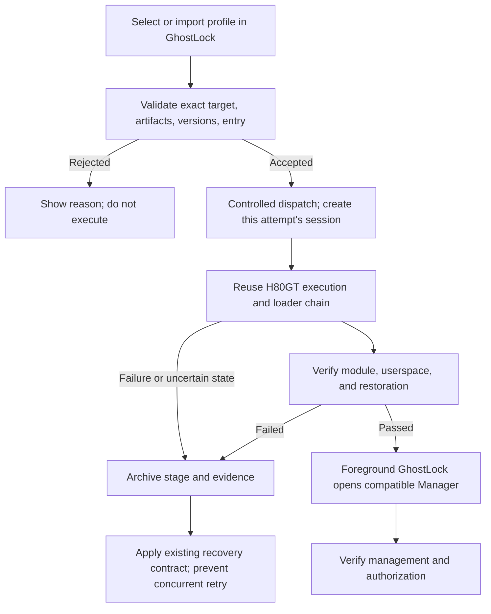

English | [简体中文](h80gt-integration-task_ZH.md)

# GhostLock integration of GhostLock-H80GT: task brief (2026-10-29)

## 1. Objective

Integrate the Honor 80 GT adaptation from GhostLock-H80GT into upstream GhostLock's profile and application workflow. The user must be able to:

1. Import or select a profile for the device in GhostLock.
2. Start the workflow from GhostLock, reusing Shizuku for the required shell identity.
3. Automatically complete the H80GT execution chain, custom KernelSU loading, userspace initialization, and final verification.
4. Enter a compatible KernelSU Manager after verification and use the authorization management and settings supported by that version.

Normal use must require no PC, terminal, manual script invocation, or copied shell commands. Document platform prerequisites such as installation and initial Shizuku activation separately.

Deliver a **verified GhostLock integration, matching profile, and APK**. A script shortcut, offset-only changes, or opening Manager alone does not complete this task.

## 2. Current state and baseline

This is a requirements and handoff document, not an approved implementation design. Preparing it involved local source inspection only, without new device operations. Current device state and the cause of the reported UI problem remain unverified.

Workspace root:

`C:/Users/lenovo/Documents/Codex/2026-10-28/https-github-com-yakidango-official-ghostlock`

| Project | Workspace location | Local baseline | Purpose |
|---|---|---|---|
| Upstream GhostLock | `work/ghostlock-app` | `437b3b2`, `main` | Integration target; origin is `YuKongA/ghostlock-app` |
| GhostLock-H80GT | `work/GhostLock-H80GT` | `33541d1`; previously recorded tag `v0.3.1` | Honor-specific implementation; origin is `yakidango-official/GhostLock-H80GT` |
| KernelSU reference source | `work/KernelSU-v3.3.1` | Verify version and commit | Manager/kernel interface reference, not evidence of compatibility |

The handoff records Honor 80 GT / `AGT-AN00`, Android 15, MagicOS `9.0.0.230`, kernel `5.10.236-android12-9-gd671cf8c2b02`. This combination exists in the H80GT target definitions. Read the connected device again before using it; historical records are not live detection. Initially support only the exact verified device/firmware combination.

Historical UI evidence is available at `work/ksu-home.png` and `work/ksu-ui.xml`. Check its date, contents, and associated installed version before relying on it, then collect current evidence through ADB. Inspect the device and screenshots directly rather than asking the user to describe the screen.

## 3. Facts and unresolved questions

### The projects use different execution chains

- Upstream resolves, merges, and validates HOCON profiles, exports GLK1 v2, and runs its Native pipeline. Current routes are `tcp_zerocopy`, `select_stack`, and `multicast_waiter`.
- Native is an executable ELF launched with `ProcessBuilder`; its packaged name, `libghostlock.so`, does not make it a JNI implementation.
- H80GT uses a firmware-specific exploit and a separate loader that handle Honor kernel differences, custom module loading, and state restoration. Do not substitute upstream's generic `ksud late-load` without proving equivalence.
- A profile can select an implementation and supply parameters, but cannot add execution capabilities absent from the APK. **There is currently no evidence that importing offsets into an unmodified upstream APK completes this adaptation.**

### KernelSU compatibility and Manager state are separate issues

- H80GT's `ksu/ksu_ko_build.sh` checks out `v3.3.0` when initially staging source. Verify HEAD when reusing its cache. Write **3.3.0**, not “3.30”; this is not an Android downgrade.
- Establish a verified compatible combination of the custom module, ksud, and Manager. Version 3.3.0 is a reproduction baseline, not a substitute for provenance and interface checks.
- Earlier handoff records mention a 3.3.1 Manager reporting “not installed” and a state change after installing 3.3.0. These observations were not revalidated while preparing this brief.
- The cause of “permissions shown but no management/settings entries” remains open. Distinguish module state, Manager recognition/initialization, interface compatibility, UI version differences, and launch timing. **Downgrading alone does not satisfy acceptance or replace diagnosis.**

## 4. Scope and constraints

### Required behavior

- Reuse GhostLock's profile import, selection, run entry point, logs, and Shizuku workflow.
- Bind the exact device, firmware, and kernel to the required implementation and artifacts. Reject mismatches and missing artifacts before execution.
- Show preparation, execution, module/userspace verification, restoration, Manager handoff, and the failing stage in the app.
- Use the selected, verified compatible Manager. Explain missing or incompatible installations; do not silently switch to another KernelSU variant.
- Preserve per-attempt configuration, artifact provenance, logs, and results. Old logs or an existing module must not produce a false success.

### Initial boundaries

- Support only the exact verified device firmware. Other target files do not establish support in the integration.
- A complete exploit rewrite or a general plugin platform is not required. Prefer existing verified capabilities.
- Exclude partition flashing, permanent root, OTA, unrelated third-party module installation, and boot persistence.
- Preserve existing routes, profiles, GLK1 v2, and legacy conversion behavior. Design necessary contract extensions under repository rules; do not invent v3/v4 or populate meaningless fields to bypass validation.
- The current request authorizes preparing this brief only. This turn does not install/uninstall Manager, reboot, or execute privilege escalation. Later device work must follow the authorization and device state applicable to that phase.

## 5. Execution stages and completion criteria

### Stage A: verify the baseline and produce a concrete design

1. Read upstream `AGENTS.md` and the design, engineering, and documentation standards. Record commits, worktree changes, and edits to preserve in both repositories.
2. Locate the actual ADB executable and verify the connected device. Record model, firmware, kernel, Manager package/version, module state, and current UI. Treat existing screenshots as historical evidence.
3. Trace actual entry points, profile resolution, dispatch, state ownership, logs, and failure exits. Inspect Manager stop/relaunch timing, APK artifact packaging, and licenses.
4. Compare the following approaches and select the smallest viable one based on change scope, behavior reuse, resource/session lifetime, and verification cost.

| Approach | Evaluation requirement |
|---|---|
| Profile only | Accept only if the existing executor demonstrably covers every required capability; that proof is currently absent |
| Profile-driven H80GT execution adapter | Evaluate first: package controlled H80GT artifacts/loader with the APK and reuse UI/Shizuku; verify packaging, access, session lifetime, status, and logs |
| Upstream Native backend/frontend/route integration | Use when it fits actual component responsibilities and has an appropriate change scope; follow component/contract/wire/test rules rather than disguising the chain as an ordinary route just to import a profile |

“Provider” means a candidate execution adapter here, not an existing API or a decided configuration field. Implementing an illustrative name does not demonstrate integration.

Upstream `AGENTS.md` classifies new routes, attack-path changes, and Native↔Kotlin/profile contracts as L-level. It requires **a bilingual concrete design and user approval before implementation**. This brief does not waive that rule. If a concrete design has already been approved in the active session, use that approval without asking again.

**Done when:** a bilingual design specifies file-by-file scope, selected approach and rationale, parameter/artifact contracts, state ownership, lifecycle, failure handling, compatibility, rollback, and batch verification. Mark unresolved points explicitly. Enter Stage B after approval of that design.

### Stage B: implement profile and application integration

1. Carry the same profile through existing import, storage, selection, and execution. Specify the selected implementation, exact target, and packaged dependencies.
2. Implement the approved adapter using H80GT source and its authoritative loader. Record source commits and changes; avoid diverging script copies.
3. Complete normal operation from GhostLock. Report missing Shizuku prerequisites before execution. Dispatch only to supported implementations; a profile must not become an arbitrary shell-command entry point.
4. Implement mutual exclusion, run state, archived logs, and failure results. Preserve execution-critical logging and timing constraints; do not introduce Binder/pipe backpressure into the critical path.
5. Manage Manager lifecycle and post-success launch using compatibility evidence. Let the foreground app own the visible handoff and handle missing launcher activities.

**Done when:** reviewable code, an actual profile, APK, and artifact manifest exist; profile/application tests and applicable Native checks pass. Mark device support pending until device verification passes.

### Stage C: verify each layer and deliver

1. Run profile, dispatch, version, packaging, state, and rejection tests that do not trigger privilege escalation first.
2. On the authorized target device, verify the complete workflow from a documented clean baseline and record repository-required gates.
3. Verify the module, userspace initialization, restoration, and Manager usability. Opening Manager or seeing a working-state label is insufficient.
4. Check Manager after a normal relaunch and verify an ordinary app's authorization entry/result using a non-destructive check. Install no unrelated modules. Archive device failures and reboots as well as passes.

**Done when:** report every acceptance item in section 8 with diffs, build commands/results, APK/profile/dependency hashes, and device evidence. Mark missing results incomplete or blocked rather than claiming theoretical success.

## 6. Target flow, state, and failures

This is a requirements diagram; the concrete design determines implementation locations. The branches are not claims about existing functionality.

- Distinguish not started, preparing, running, verifying, ready, failed, and uncertain/recovery-required states. Reuse existing state and persistence facilities where suitable.
- An existing module, running old session, transport interruption, or timeout does not establish success for the current attempt. Determine session and device state first.
- Restoration depends on coordination between H80GT's custom module and loader. Preserve actual source-defined order and verify final SELinux enforcing, normal `boot_id`, and disposition of other temporary changes. A generic “clean everything” statement is not a restoration contract.
- Once critical kernel state changes, process exit does not prove restoration. Report reboot/recovery requirements under the existing failure contract. Do not apply generic forced termination to kernel-waiting participants or restart the chain while state is unknown.
- Launch Manager only after module, userspace, and restoration checks pass. Report Manager/UI/authorization failures separately instead of treating the preceding stage as complete acceptance.

## 7. Source and documentation pointers

Paths below are relative to each repository. Modify only what the selected design requires; this is not a rewrite checklist.

| Repository/location | Purpose |
|---|---|
| Upstream `AGENTS.md`, `docs/development/{design-philosophy,engineering-standards,documentation-standards,adding-a-component}*.md` | Design, components, bilingual documentation, and verification requirements |
| Upstream `profile-core/src/main/kotlin/com/ghostlock/app/data/profile/ProfileResolver.kt`, `data/NativeProfile.kt`, `data/route/RouteKind.kt` | Validation, GLK1, and execution selection constraints |
| Upstream `app/src/main/kotlin/com/ghostlock/app/data/{AndroidProfileConfigController,AndroidGhostlockRepository,ManagerScanner}.kt` | Configuration-to-run flow, Manager discovery, results, logs |
| Upstream `app/src/main/kotlin/com/ghostlock/app/shizuku/`, `app/src/main/aidl/` | Shell entry, process contracts, and status transport |
| Upstream `app/src/main/kotlin/com/ghostlock/app/ui/{MainActivity,GhostlockViewModel}.kt`, application resources | Handoff effects, state, and messages |
| Upstream `app/src/main/assets/kernel_profiles/`, Gradle packaging tasks | Imported/built-in profile consistency and controlled artifact distribution |
| Upstream `src/core/route/{component_catalog,orchestrator,pipeline,route_policy}.hpp`, `src/core/profile/{model.h,binary.cpp}`, `src/core/session/root_child_frontend.cpp` | Component responsibilities and contracts if Native integration is selected |
| H80GT `README.md`, `release/setup.sh`, `exploit/src/targets/annap-AGT-AN00_9.0.0.230/target.h` | Target matching, specialized workflow, Manager lifecycle |
| H80GT `exploit/src/{main,sysctl}.c`, `ksu/tools/ksu_loader.tmpl`, `ksu/ksu_load_ko.sh` | Execution, restoration, failure contracts; preserve authoritative implementation |
| H80GT `ksu/{README.md,ksu_ko_build.sh}`, patches, `ksu/tools/README.md`, licenses | Module/userspace provenance, builds, compatibility, and distribution obligations |

`kernelsu.ko` is an ignored build artifact; cloning does not guarantee its presence. Record source, version/commit, build steps, SHA-256, and license for each packaged artifact. Verify the applicable GPL, Apache, and third-party obligations against the actual files.

## 8. Verification matrix and deliverables

| ID | Required result | Evidence |
|---|---|---|
| V1 | Exact-target profile imports, persists, selects, and dispatches correctly | Profile tests, effective runtime configuration, dispatch record |
| V2 | Wrong device/kernel, missing artifacts, unknown implementation, incompatible versions reject before execution | Unit/integration tests and specific errors |
| V3 | Actual APK artifacts and versions satisfy the design | APK inspection, reproducible build instructions, SHA-256 manifest |
| V4 | GhostLock UI completes the workflow without manual shell use | Device recording or staged screenshots and complete attempt logs |
| V5 | Module/userspace readiness and restoration meet the contract | Probes and loader/system logs, beyond exit codes or UI labels |
| V6 | Compatible Manager opens automatically; management/settings match its version; ordinary app authorization works | Version details, current UI evidence, non-destructive authorization result |
| V7 | Repeated taps, old sessions, timeouts/disconnections cause neither concurrent chains nor false success | Safely simulated state tests and applicable device evidence |
| V8 | Existing upstream profiles/routes pass regression checks | Tests and applicable gates, with scope rationale for untouched areas |

Use current repository build requirements. Cover at least `:profile-core:test`, `:app:testDebugUnitTest`, `:app:assembleDebug`, profile export, and APK inspection. Use `gradlew.bat` on Windows and a project-supported environment for Native tooling.

For Native changes, run the required `make -C src native-host-tests`, NDK build, and `make -C src lint-tidy`. Attack-critical changes additionally require baseline `tools/cmp_disasm.py` comparison, resource lifecycle review, and a device gate. Identify baseline binaries; unit tests do not replace those gates.

Deliver code diffs, bilingual concrete design and usage instructions, APK, profile, artifact/license manifests, test results, device gates, limitations, and rollback instructions. Commit/push and upstream PR submission were not requested; deliver a locally reviewable result first.

## 9. Progress and handoff instruction

- [x] Define the user goal, repository baselines, and key execution differences.
- [x] Write this task brief and its Chinese counterpart.
- [x] Verify current device, Manager, and compatible artifact combination.
- [x] Produce and obtain approval of the concrete L-level design.
- [x] Implement integration, build, and complete applicable checks.
- [x] Complete device verification and delivery, including an authorized app obtaining root — see the gate record.

### Implementation status (2026-10-30, batch 2)

Design: [`h80gt-integration-plan.md`](h80gt-integration-plan.md) (batch 1 approved 2026-10-29, batch 2
section approved 2026-10-30).
Usage: [`../h80gt-integration.md`](../h80gt-integration.md).
Release notes: [`../h80gt-release-notes.md`](../h80gt-release-notes.md).
Device gates: [`device-gates/H80GT-01.md`](device-gates/H80GT-01.md) (**PASS**, batch 1),
[`device-gates/H80GT-02.md`](device-gates/H80GT-02.md) (batch 2: packaging **PASS**, app-path re-gate
**blocked** by an upstream exploit bug — [`upstream-issue-h80gt-dm-page.md`](upstream-issue-h80gt-dm-page.md)).

| Item | Result |
|---|---|
| Profile | `engine = "h80gt"`, selection by kernel string; **six** profiles bundled (`8.0.0.128`, `8.0.0.160`, `9.0.0.157`, `9.0.0.200SP1`, `9.0.0.220SP2`, `9.0.0.230`); `device`/`fingerprint` optional and unused; no GLK1 document for any of them |
| Payload | schema v2 catalogue: 6 per-firmware exploits (fork-patched `prepare_dm_page()`, rebuilt with NDK r29) + 7 shared artifacts (13 unique), staged and hash-verified in the build, in the APK and again at runtime; the shared set is stored once |
| Code | profile-core engine support with nullable refinements, app adapter (payload/preflight/loader/run state/executor/manager), AIDL entry `runH80gt`, UI stage list and manager handoff |
| Tests | `:profile-core:test` 26/26; `:app:testDebugUnitTest` 129 tests, 124 pass, 2 pre-existing baseline failures (`ExporterAgreementTest`, `ProfileMigrationEquivalenceTest`); H80GT suites all pass (optional-field cases, six-payload catalogue, first-run record) |
| APK | `build/app/outputs/apk/debug/GhostLock-v1.2(1)-arm64-v8a-debug.apk`, 36,443,696 bytes, SHA-256 `c793f7bea6811b0639ab70a8961cb86e4b87de927578793a1c924fe546410804`; six exploit entries + seven shared entries + `payloads.conf` + six profiles inside, hashes match the manifest |
| Native | unchanged; `buildGhostlockNative` and `buildGhostlockExtract` built successfully as part of `:app:assembleDebug` |
| Device (batch 1) | HONOR 80 GT / `AGT-AN00` / 9.0.0.230: all eight stages completed from the UI, module live, enforcing restored, `boot_id` unchanged, manager `v3.3.0` shows `工作中 [越狱模式]`, repeat run refused before staging |
| Device (batch 2, app path) | Unpatched: three fresh-boot attempts all failed inside the exploit's physical-page walk (`SKIP out-of-ram`, `phys` 43–48 GB vs `DIRECT_MAP_END`), each classified correctly. With the shipped patched payload: **2/2 fresh-boot app-path runs PASS** — both boots hit out-of-range pages (3 and 1 retired), module loaded, `Enforcing` restored, manager auto-opened |
| App root (V6 sub-check) | **PASS after an explicit grant**: with the app's 「超级用户」 switch on, `su -c id` returns `uid=0(root) … context=u:r:ksu:s0`; MT Manager shows two `mtio` daemons as uid 0. Unlisted apps get `ENOENT` with no prompt in this session, so the grant is done in the manager first |

For the implementing agent: read this brief and upstream `AGENTS.md`, then start with Stage A. Reuse existing capabilities and propose the smallest evidence-backed design; after approval, continue through implementation and verification. Report established facts, changes, verification, and remaining work separately. Documentation, an importable profile, successful root, module loading, and a usable Manager are distinct results.
