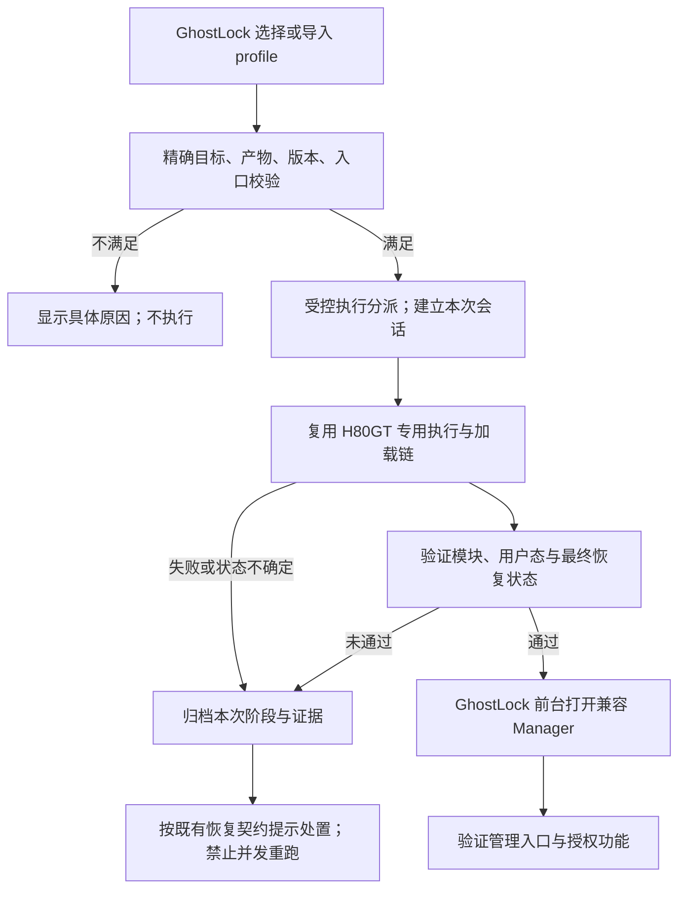

[English](h80gt-integration-task.md) | 简体中文

# GhostLock 接入 GhostLock-H80GT 任务书（2026-10-29）

## 1. 任务目标

将 GhostLock-H80GT 对荣耀 80 GT 的专用适配接入上游 GhostLock 的配置与应用工作流，使用户能够：

1. 在 GhostLock 中导入或选择适配本机的 profile。
2. 通过 GhostLock 界面发起流程，复用已有 Shizuku 能力完成必要的 shell 身份启动。
3. 自动完成 H80GT 专用执行链、定制 KernelSU 加载、用户态初始化和最终状态验证。
4. 验证成功后自动进入匹配的 KernelSU Manager，正常使用该版本支持的授权管理与设置入口。

正常使用流程无需电脑、终端、手工运行脚本或复制 shell 命令。安装、首次 Shizuku 激活等平台前置条件必须在说明中单独列出。

本任务的主要交付物是**可验证的 GhostLock 集成实现、配套 profile 和 APK**。只提供脚本快捷方式、只修改偏移表、只打开 Manager，均不构成完成。

## 2. 当前状态与基线

本任务书是需求与交接文件，不是已获认可的详细实现设计。编写本文件时仅核对本地源码，未进行新的真机操作；当前设备状态与 UI 原因尚未重新验证。

工作区根目录：

`C:/Users/lenovo/Documents/Codex/2026-10-28/https-github-com-yakidango-official-ghostlock`

| 项目 | 工作区位置 | 本地基线 | 用途 |
|---|---|---|---|
| 上游 GhostLock | `work/ghostlock-app` | `437b3b2`，`main` | 集成目标；origin 为 `YuKongA/ghostlock-app` |
| GhostLock-H80GT | `work/GhostLock-H80GT` | `33541d1`，此前记录 tag `v0.3.1` | 复用荣耀专用实现；origin 为 `yakidango-official/GhostLock-H80GT` |
| KernelSU 参考源码 | `work/KernelSU-v3.3.1` | 版本、提交需实施方核对 | 对照 Manager 与内核接口；不是兼容性证明 |

交接记录中的目标设备为荣耀 80 GT / `AGT-AN00`、Android 15、MagicOS `9.0.0.230`、内核 `5.10.236-android12-9-gd671cf8c2b02`。该固件与内核组合存在于 H80GT 的 target 定义，但当前连接设备必须重新读取确认，不能将这份记录当作实时探测结果。首期仅覆盖核实后的本机精确组合。

已有截图和 UI 导出位于 `work/ksu-home.png`、`work/ksu-ui.xml`；如用于诊断，先检查时间、内容和对应安装版本，再通过 ADB 获取当前证据。用户希望实施方直接检查设备与截图，而不是让用户转述界面。

## 3. 必须保留的事实与未决问题

### 两个项目的执行逻辑不同

- 上游以 HOCON profile 解析、合并、校验配置，再生成 GLK1 v2，交给现有 Native pipeline。当前 route 为 `tcp_zerocopy`、`select_stack`、`multicast_waiter`。
- 上游 Native 是可执行 ELF，由 `ProcessBuilder` 启动；打包文件名为 `libghostlock.so`，不是 JNI 调用。
- H80GT 具有按固件编译的专用 exploit 和独立 loader，承担荣耀内核差异、定制模块加载及相关状态恢复。上游通用 `ksud late-load` 不能未经验证就替换这条链。
- 配置可以选择执行实现、承载参数，但不能凭空增加 APK 中不存在的执行能力。**当前没有证据表明，给未经修改的上游 APK 导入一份偏移配置就能完成此适配。**

### KernelSU 版本与管理器状态分开处理

- H80GT 的 `ksu/ksu_ko_build.sh` 首次准备源码时 checkout `v3.3.0`；复用缓存目录时仍需核对实际 HEAD。版本号写作 **3.3.0**，不是“3.30”，也不是 Android 系统降级。
- 当前专用模块、ksud、Manager 应先建立同源且经过核验的兼容组合；可以以 3.3.0 作为复现基线，不能只根据文件夹名或版本字符串判兼容。
- 交接记录曾提及 3.3.1 Manager 显示“未安装”、降至 3.3.0 后状态改变；这些不是本任务书重新验证的设备结论。
- “显示有权限但没有管理/设置入口”的原因仍待查明。必须区分内核模块状态、Manager 识别/初始化、接口兼容、界面版本差异及启动时机。**降级本身不是验收结果，也不能代替诊断。**

## 4. 范围与约束

### 必须完成

- 复用 GhostLock 的配置导入、配置选择、执行入口、日志和 Shizuku 工作流。
- 精确绑定目标设备/固件/内核、所需执行能力与产物；不匹配或缺产物时在运行前明确拒绝。
- 在应用中清楚显示准备、运行、模块/用户态验证、状态恢复、Manager 交接以及失败所处阶段。
- 成功后使用用户选定且验证兼容的 Manager。缺少 Manager 或版本不兼容时提供可操作说明，不能静默切换到另一种 KernelSU 分支。
- 保留每次运行独立的配置、产物来源、日志、结果和失败证据，避免旧日志或旧模块造成成功误判。

### 本期边界

- 仅适配本机精确固件；其他 target 文件的存在不代表集成版本已经支持其他固件。
- 不要求将整个 H80GT exploit 重写为上游 pipeline，也不要求新建通用插件平台。优先复用经过验证的现有能力。
- 不增加刷写分区、永久化 root、OTA、自动安装第三方模块或开机持久化功能。
- 保留上游已有 route、profile、GLK1 v2 和旧格式转换行为。确需扩展跨层契约时按仓库规则设计，不随意引入 v3/v4 或填充无意义参数来绕过校验。
- 当前请求仅授权整理任务书；本轮不安装/卸载 Manager、不重启、不执行提权。实施阶段的设备操作依据该阶段实际授权与设备状态推进。

## 5. 实施步骤与完成条件

### 阶段 A：复核现状，形成具体设计

1. 读取目标仓库 `AGENTS.md` 与设计、工程、文档规范；记录两个仓库的提交、工作树差异和待保留修改。
2. 找到现有 ADB 的真实路径并核实连接设备；记录型号、固件、内核、Manager 包名/版本、模块状态及当前 UI。已有截图只作历史证据。
3. 画出现有入口、profile 解析、执行分派、状态所有者、日志与失败退出的实际调用链；查清 Manager 的停止与重新启动时机、产物打包方式和许可证。
4. 对比以下方案，依据改动范围、既有行为复用、状态/资源生命周期及验证成本选择最小可行方案。

| 方案 | 评估要求 |
|---|---|
| 只新增 profile | 只有证明现有执行器已覆盖全部所需能力才可采用；当前没有这种证明 |
| profile 驱动的 H80GT 专用执行适配层 | 优先评估：随 APK 提供受控的专用执行产物/loader，复用 UI 与 Shizuku；必须验证打包、访问权限、会话生命周期、状态和日志传递 |
| 接入上游 Native backend/frontend/route | 若与真实组件职责匹配且改动更合适则采用；按组件规范处理契约、目录、wire 和测试，不能只为配置能导入而伪装成普通 route |

“provider”在本文仅表示候选的专用执行适配层，不是已存在的 API 或已敲定的新配置字段。不得照抄示意名称就宣称集成完成。

上游 `AGENTS.md` 将新增 route、攻击路径和 Native↔Kotlin/profile 契约变更列为 L 级，要求**先写双语具体设计并获用户认可，再实现**。本任务书不豁免该要求；若现有会话已经认可具体设计则沿用，不重复索要同一项认可。

**完成条件：**给出一份中英文具体设计，包含逐文件范围、所选方案与理由、参数/产物契约、状态所有权、生命周期、失败处理、兼容与回退、分批验证；未确认内容逐项标明。具体设计认可后进入阶段 B。

### 阶段 B：实现配置与应用集成

1. 让同一份 profile 通过既有导入、保存、选择与运行链路，明确它选择什么实现、支持什么精确目标、依赖哪些已打包产物。
2. 按已认可设计接入执行适配层；复用 H80GT 源码与权威 loader，记录来源提交和改动，不复制多份相互漂移的脚本。
3. 使正常运行从 GhostLock 界面完成；H80GT 所需 Shizuku 条件未满足时在启动前提示。应用只能分派到明确受支持的实现，profile 不成为任意 shell 命令入口。
4. 实现互斥、运行状态、日志归档与失败结果；遵守现有关键执行阶段的日志和时序约束，不能把 Binder/管道背压引入执行关键路径。
5. 按兼容性证据控制 Manager 生命周期与成功后跳转；由应用前台负责用户可见交接，处理 Activity 不存在等失败。

**完成条件：**产生可构建的改动、实际 profile、APK 和产物清单；配置测试、应用测试及适用的 Native 检查通过，尚未通过真机前标记为待验证。

### 阶段 C：分层验证与交付

1. 先运行无需触发提权的配置、分派、版本、打包、状态与拒绝路径检查。
2. 在已获授权的目标设备上，以明确的干净基线验证完整流程；按仓库 gate 要求记录环境和结果。
3. 验证 KernelSU 模块与用户态、恢复状态及 Manager 实际可用性。打开界面和出现“工作中”均不替代功能证据。
4. 至少验证一次 Manager 正常重开后的状态，及一次普通应用授权入口/结果；使用无破坏性检查，不安装无关模块。设备失败/重启同样归档。

**完成条件：**逐项提交第 8 节验收结果，提供代码差异、构建命令与结果、APK/profile/依赖产物哈希和真机证据；缺项标记未完成或阻塞，不用“理论可用”替代。

## 6. 目标控制流、状态与失败处理

以下为需求示意，实际实现位置由具体设计确定；不表示当前代码已经具备这些分支。

- 状态至少区分：未开始、准备、运行、验证、已就绪、失败、状态不确定/需恢复。具体命名与持久化方式复用项目能力。
- 模块已存在、旧会话仍运行、通信中断或超时，不能直接算作本次成功；先判断会话与设备状态。
- H80GT 的恢复职责包括其定制模块与 loader 的配合。沿用实际源码中的状态恢复顺序，验证 SELinux 最终 enforcing、`boot_id` 正常和其他临时状态的处置，不用泛化的“全部清理”替代具体契约。
- 关键内核状态改变后，普通退出不等于已恢复；按现有失败契约标明需重启/恢复的情况。不对仍参与内核等待的进程套用通用强杀/清理方案，不在状态未知时重复启动整条链。
- 模块、用户态和最终恢复状态通过后才交接 Manager；Manager UI/授权验证失败时单独报告，不能把上一步的成功覆盖为整体验收通过。

## 7. 优先检查的代码与文档

以下路径相对各自仓库；仅在所选方案需要时修改，不是要求全部重写的清单。

| 仓库/位置 | 检查目的 |
|---|---|
| 上游 `AGENTS.md`、`docs/development/{design-philosophy,engineering-standards,documentation-standards,adding-a-component}*.md` | 设计、组件、双语和验证门槛 |
| 上游 `profile-core/src/main/kotlin/com/ghostlock/app/data/profile/ProfileResolver.kt`、`data/NativeProfile.kt`、`data/route/RouteKind.kt` | 导入后校验、GLK1、配置与执行选择约束 |
| 上游 `app/src/main/kotlin/com/ghostlock/app/data/{AndroidProfileConfigController,AndroidGhostlockRepository,ManagerScanner}.kt` | 配置到运行、Manager 发现、结果与日志 |
| 上游 `app/src/main/kotlin/com/ghostlock/app/shizuku/`、`app/src/main/aidl/` | shell 身份启动、跨进程契约与状态回传 |
| 上游 `app/src/main/kotlin/com/ghostlock/app/ui/{MainActivity,GhostlockViewModel}.kt`、应用资源 | 交接效果、运行状态和用户提示 |
| 上游 `app/src/main/assets/kernel_profiles/`、Gradle 打包任务 | profile 导入/内置一致性和受控产物交付 |
| 上游 `src/core/route/{component_catalog,orchestrator,pipeline,route_policy}.hpp`、`src/core/profile/{model.h,binary.cpp}`、`src/core/session/root_child_frontend.cpp` | 采用 Native 集成方案时的组件职责和契约 |
| H80GT `README.zh-CN.md`、`release/setup.sh`、`exploit/src/targets/annap-AGT-AN00_9.0.0.230/target.h` | 目标匹配、专用运行流程和 Manager 生命周期 |
| H80GT `exploit/src/{main,sysctl}.c`、`ksu/tools/ksu_loader.tmpl`、`ksu/ksu_load_ko.sh` | 专用链与恢复/失败契约；保留权威实现 |
| H80GT `ksu/{README.zh-CN.md,ksu_ko_build.sh}`、补丁、`ksu/tools/README.md`、许可证 | 模块/用户态来源、构建、兼容及分发义务 |

`kernelsu.ko` 是被忽略的构建产物，不能假设 clone 后存在。每项打包产物记录来源、版本/提交、构建步骤、SHA-256 和许可证；具体 GPL/Apache 及第三方义务按对应文件核对。

## 8. 验证矩阵与交付清单

| 编号 | 必须证明的结果 | 证据 |
|---|---|---|
| V1 | 精确目标 profile 可导入、保存、选择，实际分派到预期实现 | 配置测试、运行时生效配置与分派记录 |
| V2 | 错机型/内核、缺产物、未知执行实现、版本不兼容能在运行前拒绝 | 单元/集成测试及具体错误 |
| V3 | APK 的实际产物、版本与来源满足设计 | APK 内容检查、可复现构建说明及 SHA-256 清单 |
| V4 | 从 GhostLock UI 完成链条，正常流程不需要手工 shell | 真机录屏或分阶段截图与本次完整日志 |
| V5 | KernelSU 模块和用户态初始化确实就绪，最终恢复状态满足契约 | 对应状态探测、loader/系统日志；不只靠退出码或 UI 文案 |
| V6 | 自动进入兼容 Manager，管理/设置入口与该版本设计一致，普通应用授权可验证 | 当前版本信息、UI 证据、无破坏性授权检查结果 |
| V7 | 重复点击、旧会话、超时/断连不产生并发链条或成功误判 | 可安全模拟的状态测试及适用设备记录 |
| V8 | 已有上游 profile 和 route 行为回归通过 | 回归测试与适用 gate；未触及项写明范围依据 |

构建与验证命令以仓库现行规范为准，至少覆盖 `:profile-core:test`、`:app:testDebugUnitTest`、`:app:assembleDebug`、profile 导出与 APK 打包检查。Windows 使用 `gradlew.bat`；Native 工具链按项目支持环境执行。

涉及 Native 变更时按仓库要求执行 `make -C src native-host-tests`、NDK 构建和 `make -C src lint-tidy`；触及攻击关键路径时增加基线反汇编比较 `tools/cmp_disasm.py`、资源生命周期审查及真机 gate。保留基线二进制标识，不能用单元测试代替这些门槛。

最终交付：代码 diff、双语具体设计与使用说明、APK、profile、产物/许可证清单、测试结果、真机 gate、已知限制和回退步骤。未要求 commit/push 或向上游提交 PR，先交付本地可审查结果。

## 9. 进度与交接指令

- [x] 明确用户目标、仓库基线和两个项目的主要差异。
- [x] 写出本任务书和英文对应文件。
- [x] 实时复核设备、Manager 和产物兼容组合。
- [x] 提交并确认具体 L 级实现设计。
- [x] 完成配置与应用集成、构建和适用检查。
- [x] 完成真机验证与交付，含“已授权应用取得 root”——见门禁记录。

### 实施状态（2026-10-30，第二批）

设计：[`h80gt-integration-plan_ZH.md`](h80gt-integration-plan_ZH.md)（第一批 2026-10-29、第二批 2026-10-30 均获用户认可）。
使用说明：[`../h80gt-integration_ZH.md`](../h80gt-integration_ZH.md)。
发布说明：[`../h80gt-release-notes_ZH.md`](../h80gt-release-notes_ZH.md)。
真机门禁：[`device-gates/H80GT-01_ZH.md`](device-gates/H80GT-01_ZH.md)（**PASS**，第一批）、[`device-gates/H80GT-02_ZH.md`](device-gates/H80GT-02_ZH.md)（第二批：打包 **PASS**、应用路径 **PASS 2/2**（补丁载荷）；未打补丁时 3/3 失败，见 [`upstream-issue-h80gt-dm-page_ZH.md`](upstream-issue-h80gt-dm-page_ZH.md)）。

| 项目 | 结果 |
|---|---|
| profile | `engine = "h80gt"`、按内核串选择；**6 个**随包 profile（`8.0.0.128`、`8.0.0.160`、`9.0.0.157`、`9.0.0.200SP1`、`9.0.0.220SP2`、`9.0.0.230`）；`device`/`fingerprint` 可选且随包未声明；均不生成 GLK1 文档 |
| 产物 | schema v2 清单：6 个逐固件 exploit（fork 补丁 `prepare_dm_page()`，NDK r29 重编）+ 7 个共享产物（共 13 个唯一文件），在构建、打包和运行时各校验一次哈希；共享集只存一份 |
| 代码 | profile-core 引擎支持、应用适配层（载荷/preflight/loader/运行状态/执行器/管理器）、AIDL 入口 `runH80gt`、UI 阶段列表与管理器交接 |
| 测试 | `:profile-core:test` 26/26；`:app:testDebugUnitTest` 129 项、124 通过，2 项在干净基线 `437b3b2` 上同样失败（`ExporterAgreementTest`、`ProfileMigrationEquivalenceTest`）；H80GT 套件全过（可选字段、6 载荷目录、首跑记录） |
| APK | `build/app/outputs/apk/debug/GhostLock-v1.2(1)-arm64-v8a-debug.apk`，36,443,696 字节，SHA-256 `c793f7bea6811b0639ab70a8961cb86e4b87de927578793a1c924fe546410804`；包内 6 个 exploit + 7 个共享产物 + `payloads.conf` + 6 个 profile，哈希与清单逐一相符 |
| Native | 未改动；`buildGhostlockNative` 与 `buildGhostlockExtract` 随 `:app:assembleDebug` 构建成功 |
| 设备（第一批） | 荣耀 80 GT / `AGT-AN00` / 9.0.0.230：从界面跑完八个阶段，模块在列、恢复 enforcing、`boot_id` 未变，管理器 `v3.3.0` 显示 `工作中 [越狱模式]` 且超级用户与设置入口可用，第二次运行在搬运前被拒 |
| 设备（第二批，应用路径） | 未打补丁：三次干净启动都在 exploit 物理页走查里失败（`SKIP out-of-ram`，`phys` 43–48 GB 对 `DIRECT_MAP_END`），应用每次都正确分类并要求重启。补丁载荷随包后：**2/2 干净启动从界面 PASS**——两次都碰到越界页（分别弃 3 页、1 页），模块加载、`Enforcing` 恢复、管理器自动打开 |
| 应用 root（V6 子检查） | **显式授权后 PASS**：打开该应用的「超级用户」开关后 `su -c id` 返回 `uid=0(root) … context=u:r:ksu:s0`；MT 管理器有两个 `mtio` 守护进程以 uid 0 运行。本会话未列入的应用 `su` 得到 `ENOENT` 且不弹框，因此需先在管理器里授权 |

给接手执行方：先阅读本文件和上游 `AGENTS.md`，从阶段 A 开始。优先复用两个项目已经存在的能力，提出有代码证据的最小集成设计；认可设计后继续实现与验证。请分别报告“已证明的现状”“本批改动”“验证结果”“尚未完成”，不要把文档、可导入配置、root 成功、模块加载和 Manager 可用这五件事混为一谈。
